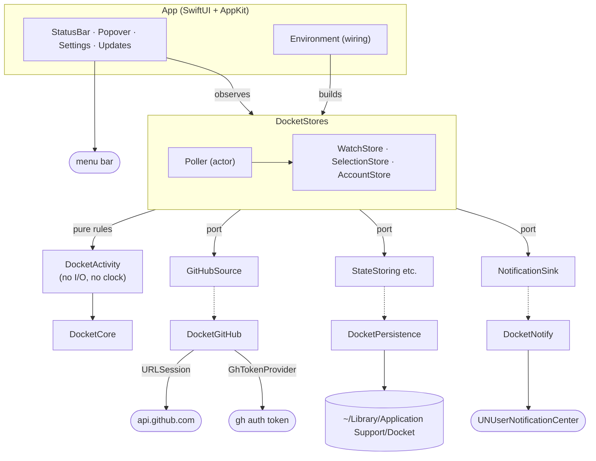
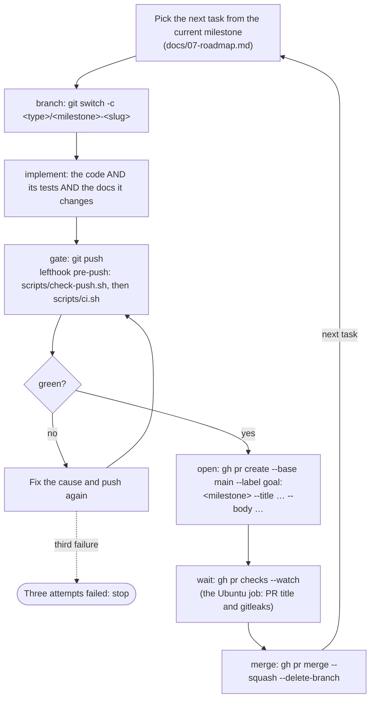

# CLAUDE.md

This file provides guidance to Claude Code (claude.ai/code) when working with code in this
repository. It is written to be useful to any other agent too — nothing in it is specific to one
tool.

## What this project is

Docket is a macOS menu bar app that lists your open pull requests and the ones waiting for your
review, with status, age and local tags, and notifies you — grouped by repository — when a review
is requested, submitted, or a comment of yours is answered. It reads GitHub with the token of the
signed-in GitHub CLI. The plan is written down in detail and is the source of truth for behaviour:

| If you are about to… | Read |
|---|---|
| implement or change any behaviour | [`docs/01-product.md`](docs/01-product.md) for the `FR-xx` it belongs to |
| change which pull requests are watched, a status, the count, or when a notification fires | [`docs/02-activity-detection.md`](docs/02-activity-detection.md) — and add its worked example to §8 |
| add a target, an import between targets, or a port | [`docs/03-architecture.md`](docs/03-architecture.md) §3 and §7 |
| touch the token, `gh`, scopes or SAML | [`docs/03-architecture.md`](docs/03-architecture.md) §6 |
| add or change a field in `config.json`, `state.json` or `cache/` | [`docs/04-data.md`](docs/04-data.md) |
| change a view, a chip, notification copy or a settings screen | [`docs/05-design.md`](docs/05-design.md) |
| change hooks, `scripts/ci.sh`, workflows or the release | [`docs/06-engineering-practices.md`](docs/06-engineering-practices.md) |
| pick the next task | [`docs/07-roadmap.md`](docs/07-roadmap.md) |
| add a dependency | [`docs/08-stack.md`](docs/08-stack.md) — the row, its reason and its cost to replace go in with it |
| set up signing, secrets or `gh` | [`docs/09-provider-setup.md`](docs/09-provider-setup.md) |

**A PR that changes behaviour described in `docs/` updates that document in the same PR.**
Documentation drift is the failure mode of a plan this detailed. Where the plan and the code
disagree about what the product does, the code is right and the plan has a bug — fix the plan in
the same PR.

## What exists today

The plan describes the finished system. The repository is part-way there, and the rest of this file
describes the target rather than the tree, so check here before reaching for something.

| Built | Not built yet |
|---|---|
| The plan: `PROJECT.md`, `docs/01`–`09`, this file, `README.md` | Nothing in `M0`–`M5`. The Focus filter's `perform` calls are not yet confirmed on the installed macOS (task 5.2a's spike) |
| Toolchain and gate: `package.json`, `lefthook.yml`, `scripts/ci.sh`, `scripts/check-push.sh`, the `pr` and `Release` workflows, release-please, the `main` ruleset | |
| `DocketKit`: every target with its tests — the poll engine, events, folding, the cap, reminders, retention, triage, seen state, filters, selection, the GraphQL client, the `gh` token, the stores, notifications, updates | |
| The app: status item, popover with segmented tabs, Humans/Bots/Stale sub-tabs, multi-value filters, pinned repository headers, seen/unseen rows, GitHub labels, *Mine* as a list or board, Open in Jira and the AI actions, account screens, every settings tab, notifications, reminders, the Focus filter and digest, keyboard navigation, the global shortcut, export and import, What's New, updates, launch at login, `--snapshot` | Review with AI in terminals other than Terminal and iTerm is untested |
| `docket-cli whoami`, `poll`, `stats` | |
| Signing: the self-signed identity, the update key, their secrets and scripts | |

A PR that builds one of these moves it to the left column; the last PR of a milestone updates this
table.

## Non-negotiables

1. **Everything committed is in English** — code, identifiers, comments, commit messages, PR titles
   and bodies, documentation. Product copy is English too and lives in `Localizable.xcstrings`,
   never inline in a view (D-18).
2. **Every change is a pull request.** `main` is the only merge target and nobody pushes to it, not
   even the maintainer, not even for a typo. `scripts/check-push.sh`, run by `pre-push`, refuses a
   push to `refs/heads/main` (D-13).
3. **`DocketActivity` and `DocketCore` perform no I/O.** No `URLSession`, `FileManager`, `Process`,
   `UserDefaults`, no `Date()` or `Date.now`, no randomness. Time arrives as an argument.
   Enforced by `apps/macos/scripts/check-imports.sh`, not by discipline.
4. **The app target is wiring.** Logic lives in `DocketKit` with tests; views see stores, never
   adapters. Only `App/Sources/Environment/` imports `DocketGitHub`, `DocketNotify` or
   `DocketPersistence`.
5. **Docket never writes to GitHub.** No mutation, no marking notifications read, no labels.
6. **The token is never stored, logged or passed on.** It lives in memory, goes only in the
   `Authorization` header to GitHub, and never reaches disk, a log line, a child process or the
   pasteboard (`docs/04-data.md` §6).
7. **Nothing leaves the Mac except requests to GitHub.** No telemetry, no crash reporter, no
   third-party runtime package (`docs/08-stack.md` §1).
8. **Never commit real data.** No real login, organization, repository name, pull request title or
   token in fixtures, tests, snapshots or docs. Fixtures are synthetic (`acme/api`, `ana`, `you`).
   gitleaks runs on every commit and pull request.
9. **No mocking of our own modules.** Tests replace the network (`URLProtocol`), the process runner
   and Notification Center at their edges (`docs/03-architecture.md` §7).
10. **Comments are rare** — only for a non-obvious "why", never to narrate code.

## Commands

| Command | What it does |
|---|---|
| `brew bundle` | Installs `xcodegen`, `swiftlint`, `gitleaks`, `gh` |
| `corepack enable && pnpm install` | Installs commitlint, Biome and lefthook, and installs the git hooks |
| `./scripts/ci.sh` (or `pnpm run ci`) | The gate: every check, all of them, reported at the end. `pre-push` runs it. `CI_FAST=1` skips the app build. `pnpm ci` without `run` is pnpm's own command |
| `pnpm test` / `pnpm lint` / `pnpm format` / `pnpm build` | Delegate to `make -C apps/macos …` |
| `make -C apps/macos gen` | Generates `Docket.xcodeproj` from `project.yml` (not committed) |
| `make -C apps/macos build` / `test` / `lint` / `format` | Build the app, run `DocketKit` tests, lint, format |
| `make -C apps/macos install` | Builds Release, signs with the self-signed identity, installs to `/Applications` |
| `make -C apps/macos strings` | Syncs every string the code looks up into `Localizable.xcstrings` (D-18) |
| `swift run --package-path apps/macos/Packages/DocketKit docket-cli poll` | One real poll against your account: roles, statuses, events, `rateLimit.cost` |
| `docket-cli whoami` / `docket-cli stats` | Token, login and scopes / the success metrics of `docs/01-product.md` §5 |
| `Docket.app/Contents/MacOS/Docket --snapshot <dir>` | Renders views with synthetic data to PNG, light and dark, then exits |
| `log stream --predicate 'subsystem == "com.eliasjnior.docket"'` | Live logs |

None of these have anything to run until `M0` lands; they arrive with the code they act on.

## Architecture in one screen



## Target boundaries

Enforced by SwiftPM: an `import` of an undeclared dependency does not compile. The two rules the
compiler cannot see are enforced by `check-imports.sh` in the gate.

| Target | May import | Must never import |
|---|---|---|
| `DocketCore` | `Foundation` | any other target, `AppKit`, `SwiftUI`, `Network` |
| `DocketActivity` | `DocketCore`, `Foundation` | any I/O API listed in non-negotiable 3 |
| `DocketGitHub`, `DocketPersistence`, `DocketNotify`, `DocketUpdate` | `DocketCore`, system frameworks | each other, `DocketStores` |
| `DocketStores` | `DocketCore`, `DocketActivity`, `DocketPersistence`, `DocketUpdate` | `DocketGitHub`, `DocketNotify` — it gets them through ports |
| `DocketCLI` | `DocketCore`, `DocketActivity`, `DocketGitHub` | `DocketPersistence`, `DocketNotify`, `DocketStores` |
| App target | `DocketStores`, `DocketCore`; adapters only in `Environment/` | — |

## Conventions

- **Swift 6 language mode, complete strict concurrency.** Services are actors; stores and views are
  `@MainActor @Observable`; models are `Sendable` value types. `@unchecked Sendable` only in
  `DocketNotify`'s delegate bridge.
- **Vocabulary** is `PROJECT.md` §7, in code as in copy: `PullRequest`, `Role`, `Status`,
  `Snapshot`, `Event`, `Cursor`, `Tag`, `Selection`. "Tag", never "label".
- **Identity** is the GraphQL node ID; `owner/name#number` is display only (D-09).
- **Dates** are `Date` in UTC from the server; formatting happens only in views. `now` is injected.
- **Errors** are typed enums per target (`GitHubError`, `TokenError`, `PersistenceError`), mapped
  to an `AccountState` the popover renders. No `try!`, no force unwraps outside tests.
- **Logging** through `os.Logger`, titles and logins `privacy: .private`, the token never
  (`docs/03-architecture.md` §12).
- **Files:** one main type per file, named after it.

## Testing

| Layer | Runs against | In `swift test`? |
|---|---|---|
| `DocketActivity` | Synthetic snapshots; `docs/02-activity-detection.md` §8 verbatim as parameterized cases, plus properties over generated input | Yes |
| `DocketGitHub` | The real client over a `URLProtocol` stub with recorded, anonymized fixtures | Yes |
| `DocketPersistence` | Real stores over a temporary directory, including corrupt and future-version files | Yes |
| `DocketStores` | Composed like `AppEnvironment`, stubs at the edges, injected clock: polls, restarts, sleep | Yes |
| Views | `Docket --snapshot <dir>`, inspected as PNG — screen capture is not available to agents | No |
| Live | `docket-cli poll` against your own account | No — never in the gate |

Coverage fails the gate below 90% lines for `DocketActivity` and 75% for `DocketKit` (NFR-09).
Properties that always hold: your own items never produce an event; a snapshot diffed with itself
produces nothing; one poll delivers at most five notifications; no reminder is sent inside quiet
hours or while holding, nor two for one pull request in one poll; an ignored pull
request is never counted; every summary maps to exactly one status; a
crash between commit and delivery never causes a second delivery. Details in
[`docs/06-engineering-practices.md`](docs/06-engineering-practices.md).

## Repository

`git@github.com:eliasjnior/docket.git` — private. `main` is the only merge target. Every pull
request is opened against it. There is no second remote and no fork.

## The delivery loop

**In this repository the agent drives the whole pull request loop**, overriding any global rule
about opening pull requests by hand — the same agreement as in Lookout.

One task in, one merged commit out. Repeat until the milestone's **Done when** is true.



The gate runs **before** the pull request exists, so a red branch never becomes somebody's review.
**It runs only on this machine** (D-12): `git push --no-verify` is a way past the only gate there
is, and a green pull request proves only that whoever pushed it did not use that flag.

- **Branches:** `feat/m1-<slug>`, `fix/<slug>`, `chore/…`, `ci/…`, `docs/…`.
- **Commits and PR titles:** Conventional Commits, scoped by target or area — `macos`, `core`,
  `activity`, `github`, `persistence`, `notify`, `stores`, `update`, `cli`, `ci`, `deps`,
  `release`, `repo`, `docs`. Squash merge makes the PR title the commit on `main`.
- **Size:** under ~400 changed lines, excluding lockfiles, fixtures and snapshots.
- **Body:** what changed · why (milestone and `FR-xx`) · how it was verified · the risk if it is
  wrong.
- **Releases:** at the end of a milestone, merge the release-please pull request.

**Auto-merge only when every one of these holds:** the change is inside the current declared goal;
every required check passes — the `pre-push` gate green and the Ubuntu job green; there is no
`needs-human` label; no file is touched under `.github/workflows/`, `scripts/ci.sh`,
`scripts/check-push.sh`, `lefthook.yml`, `check-imports.sh`, `check-coverage.sh`, the signing
scripts, the signing settings or `DocketUpdatePublicKey` in `project.yml`, or anything holding
secrets; no on-disk format changed (a file's `version` in `docs/04-data.md` §1, or how an existing
version decodes); no public type in `DocketCore` or `DocketActivity` changed; the decision register
in `PROJECT.md` §6 did not change; the diff is within the size budget. If any condition fails:
apply `needs-human`, write why in a comment, and stop. Do not work around the condition.

**When a check fails:** read the failing job, fix the actual cause, push. Three attempts maximum,
then label `needs-human`, write down what was tried, and stop. Never "fix" a check by deleting a
test, skipping a test, loosening a lint rule, adding an ignore comment, widening a type, adding
`any`, pushing with `--no-verify`, or re-running the job hoping for a different result. In Swift
terms, the same list includes a force unwrap, `try!`, `@unchecked Sendable`, `nonisolated(unsafe)`
and a `// swiftlint:disable`.

**Come back to a human when**, and only when: the milestone is done, `needs-human` was applied, a
decision in the register turns out to be wrong, or the work needs a `D-xx` that does not exist.

When a milestone's **Done when** becomes true, update the "What exists today" table above in the
same pull request as the last task of that milestone.

## Local development

```bash
brew bundle
corepack enable && pnpm install
make -C apps/macos gen build
```

- The `.xcodeproj` is generated. Edit `project.yml`, never the project in Xcode's target settings;
  `make gen` overwrites it.
- Debug builds are ad-hoc signed: notification permission and the updater's code-signature check
  behave differently from an installed Release build. Check notifications with `make install`.
- The app and `docket-cli` read the same `gh` token. Running both at once is fine; they do not
  share state, and `docket-cli` never writes `~/Library/Application Support/Docket/`.
- To start from a first launch, quit Docket and delete `~/Library/Application Support/Docket/`
  (`docs/04-data.md` §4).
