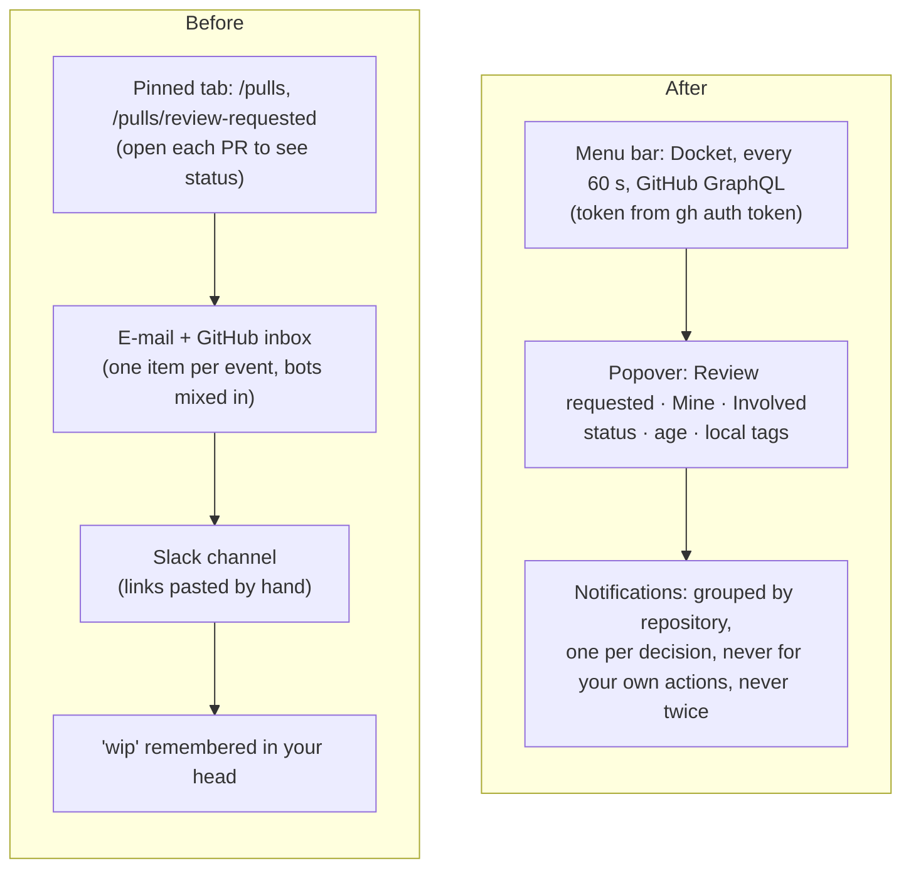

# Docket

> A macOS menu bar app that lists the open pull requests you wrote and the ones waiting for your
> review, with each one's status, how long it has been open and your own local tags, and that
> notifies you — grouped by repository — when someone requests your review, reviews your pull
> request or replies to a comment of yours.

This repository holds the plan for Docket and, as it is built, the code. It follows the shape of
Lookout (`eliasjnior/lookout`): a native Swift app in `apps/macos`, a Swift package with one target
per concern, and the same toolchain, release and update mechanism. Docket reads GitHub with the
token of the GitHub CLI the user is already signed in to, so it introduces no application an
organization has to approve.

**Status:** planning (no code written yet).

---

## 1. The problem

The predecessor is a habit: the GitHub web UI kept in a pinned tab, GitHub's e-mail notifications,
and a Slack channel where people paste links and ask for reviews. Each part fails in its own way.

**The review queue has no single view with status.** `github.com/pulls/review-requested` lists the
pull requests waiting for a review, but not whether their checks pass, whether they conflict, or
how long they have waited; `github.com/pulls` lists authored ones with a check icon and nothing
about the review state. Answering "what do I need to do right now" means opening every pull request
in turn, several times a day.

**Notifications arrive per event, not per decision.** GitHub's notification inbox and e-mail send
one item per comment, per push, per check run, per subscribed thread. A review request from a
colleague sits between forty CI and Dependabot items, so the one that matters is the one that gets
read last. The inbox cannot say "three reviews were requested in `acme/api` this morning"; it can
only say each of them, separately, among everything else.

**Replies to your own comments are the easiest thing to miss.** When you leave a review comment on
somebody else's pull request and they answer it, GitHub files the reply under the same `comment`
reason as every other comment on that pull request. Nothing distinguishes "they answered your
question" from "a bot posted coverage". The usual result is a thread that waits a day for an answer
that took ten seconds to give.

**Age is invisible until it is embarrassing.** Neither list shows how long a pull request has been
open or how long a review request has waited. A pull request opened on Monday and requested on
Tuesday looks the same as one requested an hour ago, until somebody asks in the channel.

**What you are working on lives in your head.** There is no private way to mark a pull request as
`wip`, `blocked-infra` or `after-release`. A GitHub label is shared with the whole team, needs
write access, and shows up for everyone — so nobody uses labels for this, and the information is
lost.

**Every third-party dashboard needs an organization to approve it.** Tools that solve part of this
are OAuth apps or GitHub Apps. In an organization with third-party application restrictions, each
needs an administrator to approve it before it can read a single private repository, and a request
to approve a personal productivity tool is the kind that waits.

---

## 2. The proposal

Concretely:

- **One menu bar item with a count.** The count is the number of pull requests that need you now:
  review requests waiting on you plus authored pull requests that are blocked on you
  (`docs/02-activity-detection.md` §4).
- **Three lists in one popover.** *Review requested* (grouped by repository), *Mine* and
  *Involved* — pull requests you are not the author of and were not asked to review, but have
  commented on or reviewed. Each row carries one status chosen by precedence, the age, and the tags.
- **Notifications computed from state, not forwarded from a feed.** Each poll produces a snapshot;
  Docket compares it with the last one it saw and emits only the events that are new, from somebody
  other than you, about a pull request you watch. GitHub's own inbox is never read or marked.
- **Grouping by repository.** Events of the same kind in the same repository in the same poll
  become one notification, and macOS stacks a repository's notifications in one group.
- **Local tags.** Free-text tags such as `wip`, stored only on this Mac, keyed by the pull request's
  stable node ID, filterable in the popover.
- **The GitHub CLI's token.** Docket runs `gh auth token` and holds the result in memory. The
  organization already allows GitHub CLI, so Docket adds nothing to approve.

---

## 3. Design principles

Tie-breakers, in order. When two options are defensible, the one higher on this list wins.

1. **A notification is a promise that something needs you.** Never notify for your own actions,
   never twice for the same event, never for the backlog that existed before Docket started
   watching. When in doubt, show it in the list and do not notify. A missed notification costs a
   delay; a noisy one costs the user turning notifications off, which loses every later one.
2. **Reconcile state, do not consume a feed.** Every poll fetches what is true now and compares it
   with what was true last time. A missed poll, a sleep, a crash or a reinstall leaves nothing to
   replay — the next poll's diff is the whole recovery path.
3. **Read only.** Docket never writes to GitHub: no comments, no labels, no marking notifications
   read, no merge button. Anything that would act on GitHub opens the pull request in the browser
   instead.
4. **Nothing leaves this Mac except the requests to `api.github.com`.** No telemetry, no crash
   reporter, no server of ours. Tags, selection and caches are files in
   `~/Library/Application Support/Docket/`.
5. **Logic lives in the kit and is tested; the app target is wiring.** Status precedence, diffing,
   coalescing and age formatting are pure functions in `DocketActivity` with no I/O, tested over
   fixed snapshots. If a behaviour needs a window to be tested, it is in the wrong target.
6. **Spend the rate limit like a budget.** A poll fetches details only for pull requests whose
   `updatedAt` moved, every query asks for its own `rateLimit { cost }`, and Docket slows down
   before GitHub makes it.
7. **Match Lookout unless this project has a reason not to.** The same layout, toolchain, signing
   and updater, so one person can move between both repositories without re-learning either. A
   difference is a `D-xx` with its reason.

---

## 4. Scope

### v1.0 — see, then be told

- A menu bar item with the count of pull requests that need you, and a popover with the three lists
  of §2.
- Status per pull request — conflict, checks failing, changes requested, checks running, ready to
  merge, waiting for review, no reviewers — plus draft as a modifier
  (`docs/02-activity-detection.md` §3).
- Age of every pull request and, for review requests, how long the request has waited.
- Notifications for review requested (directly or through a team), review submitted on your pull
  request, new comment on your pull request, and reply in a review thread you took part in.
  Grouped by repository, coalesced per poll, deduplicated across restarts.
- Reminders of review requests still pending after an interval (1 hour by default, on by
  default), paused by quiet hours, and a per-pull-request mute — for reminders only, or for
  every notification.
- Ignore a pull request: out of the count, into a collapsed section, never notifying.
- Repository selection: all by default, with an exclusion list, or only a selected list; and the
  same at organization level.
- Local tags, with a filter.
- Authentication through `gh auth token`, with explicit screens for "gh is not installed", "gh is
  not signed in", "token lacks a scope" and "organization requires SAML authorization".
- Launch at login, settings, self-update from GitHub Releases, What's New.

### v1.1 / v1.2

- Notification when checks fail on your pull request, and when your pull request is merged or
  closed by somebody else.
- A mention of you in a comment as its own event kind.
- Holding notifications during a Focus that has Docket's Focus filter, delivered as one digest per
  repository when the Focus ends.
- Keyboard navigation of the popover and a global shortcut to open it.
- Export and import of `config.json`.

### Out of scope

- **GitHub Enterprise Server.** `gh` supports other hosts, but every query, URL and SSO behaviour
  would need a second test surface for a user who does not have one. **Revisit if** a GHES host is
  actually in use; `gh auth token --hostname` already returns its token.
- **Writing to GitHub** (approve, merge, comment, re-request). Principle 3. The browser is one click
  away and is where the diff is.
- **Issues, discussions, releases, Actions runs.** Docket is about pull requests waiting on people.
  **Revisit if** the review queue is solved and something else becomes the daily friction.
- **Syncing tags between Macs.** It would need a server or iCloud, and a tag is a note to yourself
  about what you are doing on this machine. **Revisit if** a second Mac is used daily.
- **Windows and Linux.** The product is a menu bar item; the platform is the product.
- **A webhook-driven backend.** It would need a public server, a GitHub App the organization
  installs, and someone to run it — every cost §1 exists to avoid (D-06).
- **Quiet hours for events.** macOS Focus already silences notifications by schedule and by
  context, and a second mechanism would disagree with it. Docket's own quiet hours cover reminders
  only (D-24).

---

## 5. Document map

| Document | What it settles |
|---|---|
| [`docs/01-product.md`](docs/01-product.md) | Personas, jobs, the `FR-xx` / `NFR-xx` inventory, success metrics, non-goals |
| [`docs/02-activity-detection.md`](docs/02-activity-detection.md) | Which pull requests are watched, how status and age are derived, how a poll becomes events, how events become notifications |
| [`docs/03-architecture.md`](docs/03-architecture.md) | Targets and their boundaries, the poll loop, the GitHub port, authentication, concurrency, distribution |
| [`docs/04-data.md`](docs/04-data.md) | Every file on disk and its schema, retention, what is not stored, how the token is held |
| [`docs/05-design.md`](docs/05-design.md) | The status item, the popover, rows, chips, notification copy, settings, the review checklist |
| [`docs/06-engineering-practices.md`](docs/06-engineering-practices.md) | Toolchain, branches, commits, the delivery loop, the check suite, hooks, release and signing |
| [`docs/07-roadmap.md`](docs/07-roadmap.md) | Milestones with "Done when", risks, definition of done |
| [`docs/08-stack.md`](docs/08-stack.md) | Every dependency, why, what replacing it costs, what was deliberately not used |
| [`docs/09-provider-setup.md`](docs/09-provider-setup.md) | Installing and signing in to `gh`, scopes, SAML authorization, signing keys and repository secrets |

[`CLAUDE.md`](CLAUDE.md) is the working agreement for anyone — human or agent — writing code here.

---

## 6. Decisions

Open decisions carry a recommendation. Closed decisions keep their ID and gain the reasoning, so a
question is never re-litigated by accident.

| ID | Decision | Resolution | Impact |
|---|---|---|---|
| **D-01** | ~~Platform and language~~ | **Closed — a native macOS app in Swift 6, SwiftUI with AppKit for the status item, like Lookout.** The user asked for "something similar to Lookout", and the product is a menu bar item: `NSStatusItem`, `NSPopover`, `UNUserNotificationCenter` and `SMAppService` are the whole surface, and each is first-class only in Swift. An Electron or Tauri tray app was the alternative; it costs 100–200 MB of memory for a list of twenty rows, renders the popover in a web view that does not look like the menu bar it sits under, and shares nothing with Lookout. **Revisit if** a second platform becomes a requirement. `docs/03-architecture.md` §2 | Resolved |
| **D-02** | ~~Authentication~~ | **Closed — the GitHub CLI's token, read with `gh auth token` at launch and on every `401`, held in memory only.** The user asked not to need the organization's authorization. Every alternative needs it or something like it: Docket's own OAuth app (device flow) is a new third-party application that a restricted organization must approve; a GitHub App must be installed by an organization owner; a fine-grained token must be approved by an organization that requires approval of fine-grained tokens. A classic personal access token in the Keychain works and was the runner-up, but it is a second credential to create, scope, SAML-authorize and rotate for a user who already has one. **The uncomfortable part:** this works because the organization allows GitHub CLI; an organization that restricts OAuth apps and has not approved GitHub CLI blocks Docket exactly as it blocks `gh`. **Revisit if** `gh` stops being installed on the user's machines — then a classic token in the Keychain is the fallback, behind the same `TokenProvider` port. `docs/03-architecture.md` §6 | Resolved |
| **D-03** | ~~Name~~ | **Closed — Docket.** A docket is the list of cases waiting to be heard, which is what the popover is. "GitHub Track", the working folder name, was rejected: GitHub's trademark policy does not allow "GitHub" in a product name, and renaming after a release means a new bundle identifier, which loses notification permission and settings. Bundle identifier `com.eliasjnior.docket`, kit `DocketKit`, targets prefixed `Docket`. **Revisit** never after the first release. | Resolved |
| **D-04** | ~~Repository and visibility~~ | **Closed — `eliasjnior/docket`, private.** The user named it and its visibility. Private changes two things downstream: the check suite cannot run on hosted macOS runners for free (D-12), and GitHub Free does not protect branches of private repositories (D-13). **Revisit when** the repository goes public: then both decisions reopen. | Resolved |
| **D-05** | ~~What "projects" means~~ | **Closed — repositories, identified as `owner/name`.** "Projects" in the request means the repositories whose pull requests the user wants to follow; GitHub Projects (the boards) are a different product and contain issues as well. Selection is a mode — *all* with an exclusion list (the default), or *only* an inclusion list — plus the same at organization level (`docs/02-activity-detection.md` §2.3). | Resolved |
| **D-06** | ~~Polling or webhooks~~ | **Closed — polling the GraphQL API, every 60 s by default.** Webhooks need a public endpoint and a GitHub App installed by an organization owner — a server to run and the approval D-02 exists to avoid. Polling one user's pull requests costs a few points of a 5000-point hourly budget (`docs/02-activity-detection.md` §6) and its worst case is a minute of latency, which is shorter than anyone takes to read a notification. **Revisit if** the poll's measured cost exceeds 10% of the hourly budget at the user's real volume. | Resolved |
| **D-07** | ~~Notification source: snapshot diff or the notifications API~~ | **Closed — diff of consecutive snapshots of pull request state.** GitHub's `/notifications` endpoint was the alternative and is what other tools use. It was rejected because it reports a *thread* and a *reason*, not the event: a reply to your comment and a bot's comment arrive as the same `comment` reason on the same thread, which is the exact failure in §1. It is also shared state with the user's GitHub inbox. Diffing snapshots gives the event itself — which review, by whom, replying to which comment — and is a pure function over two values, so every rule has a test. **Revisit if** GitHub exposes per-event notification payloads. `docs/02-activity-detection.md` §5 | Resolved |
| **D-08** | ~~Which pull requests are watched~~ | **Closed — three roles: *authored*, *review requested* (directly or through a team) and *involved* (commented on or reviewed by you, updated in the last 30 days).** The request names the first two; the third is what makes "someone replied to my comment" possible on a pull request that is not yours. Each pull request has exactly one role, chosen by precedence *authored* > *review requested* > *involved*. `docs/02-activity-detection.md` §2 | High |
| **D-09** | ~~Identity of a pull request~~ | **Closed — the GraphQL node ID (`PR_kw…`).** `owner/name#number` was the alternative and is what people read; it changes when a repository is renamed or transferred, which would orphan tags and notification cursors silently. `owner/name#number` is kept beside the ID for display. | Resolved |
| **D-10** | ~~Where tags and settings live~~ | **Closed — JSON files in `~/Library/Application Support/Docket/`, split by who writes them: `config.json` for what the user decides (selection, preferences, tags), `state.json` for what the app decides (cursors, delivered notifications, poll bookkeeping), `cache/` for the last snapshot.** SQLite through GRDB was the alternative and was rejected: tags are a map from an ID to at most five strings, a few hundred entries, read whole into memory; a database would add a dependency and migrations for a dictionary lookup. SwiftData was rejected for an opaque schema whose migrations are hard to test. Splitting by writer means a corrupt or reset `state.json` costs at most one round of re-baselining and never touches a tag. **Revisit if** a searchable history of events is wanted, entries reach the thousands, or a query crosses tags, repositories and dates. The user asked about SQLite and agreed with this split. `docs/04-data.md` §2 | Resolved |
| **D-11** | ~~Root toolchain with one app~~ | **Closed — pnpm at the root for commitlint, Biome and lefthook only; no Turborepo.** Lookout has Turborepo because it builds a Swift app and a web page; Docket has one app, and a task graph of one node is configuration without a job. The layout keeps `apps/macos` so a second app lands where it would in Lookout. **Revisit when** a second app exists — then add Turborepo exactly as Lookout has it. `docs/08-stack.md` | Low |
| **D-12** | ~~Where the check suite runs~~ | **Closed — `scripts/ci.sh` behind lefthook's `pre-push`, with only a cheap Ubuntu job on GitHub Actions.** Hosted macOS minutes on a private repository count ten times against the 2000-minute monthly allowance of GitHub Free: a 6-minute build-and-test is 60 minutes, so about thirty pull requests a month would exhaust it. The Ubuntu job checks the pull request title and runs gitleaks, at 1× cost. **What is lost is real:** the Swift checks are enforced by the author's own machine, so `git push --no-verify` is a way past the only gate there is, and a green pull request proves only that whoever pushed it did not use that flag. **Revisit when** the repository goes public (D-04): then the macOS job moves to Actions, as in Lookout, and the same script is what it runs. `docs/06-engineering-practices.md` | Medium |
| **D-13** | Protecting `main` on a private repository | **Open. Recommendation: protect `main` with a ruleset if the account plan allows it; enforce it locally either way.** GitHub Free does not offer branch protection or rulesets on private repositories; GitHub Pro does. Lefthook's `pre-push` refuses any push whose remote ref is `refs/heads/main`, so the rule holds on this machine regardless of plan. The first task of `M0` checks the plan and closes this. `docs/06-engineering-practices.md` | Medium |
| **D-14** | ~~Updater~~ | **Closed — Lookout's updater, copied into `DocketUpdate`: GitHub Releases, an Ed25519-signed archive, a designated-requirement check, no appcast.** Sparkle was the alternative; it needs an appcast host and its own signing tool for what Lookout already does in one tested target. Releases of a private repository are invisible to anonymous requests, and Lookout solves that with a pasted read-only token; Docket already holds the `gh` token, whose `repo` scope reads them, so there is nothing to paste. **Copied, not shared:** a shared package between two repositories would version-lock them for a target that changes once a year. **Revisit if** a third app needs it — then extract it into its own package. `docs/03-architecture.md` §10 | Low |
| **D-15** | ~~Code signing without an Apple Developer account~~ | **Closed — a self-signed certificate, `Docket Self-Signed Code Signing`, as in Lookout.** Notification permission and Keychain access are bound to the designated requirement, which stays stable across builds signed by the same certificate; that is the only property needed. Notarization would need the paid account for an app installed by its own author. **The cost:** on macOS 15 a browser-downloaded archive is blocked once and must be allowed under System Settings → Privacy & Security → **Open Anyway**; `gh release download` and `make install` avoid the quarantine entirely (`docs/09-provider-setup.md` §6.2). **Revisit if** the app is distributed to anyone else. `docs/09-provider-setup.md` | Low |
| **D-16** | ~~Bots in notifications~~ | **Closed — bot authors never notify by default; they still appear in the list.** Bot comments (coverage, Dependabot, preview deployments) are the noise of §1. An account is a bot when GraphQL types its author as `Bot` or its login ends in `[bot]`. A per-login allowlist lets a bot through — for example an AI reviewer whose review the user wants to know about. `docs/02-activity-detection.md` §5.4 | Medium |
| **D-17** | ~~Domain vocabulary~~ | **Closed — see §7.** One word per concept across code, documents and copy. "Tag" in particular, never "label": a GitHub label is shared and remote, a Docket tag is private and local, and using one word for both would invite the bug of syncing them. | Resolved |
| **D-18** | ~~Product copy language~~ | **Closed — English, like everything else.** The user's repositories and GitHub itself are in English, and notification text quotes pull request titles verbatim. Copy lives in a String Catalog (`Localizable.xcstrings`), never inline, so a Portuguese translation is a file, not a refactor. **Revisit if** the user wants the interface in Portuguese. | Low |
| **D-19** | ~~First poll after launch~~ | **Closed — the first successful poll on a fresh install establishes the baseline and emits no notifications.** The alternative — notify everything pending — turns the first launch into a burst of stale notifications, which breaks principle 1. Pending review requests are still counted and listed. The baseline is persisted, so a later launch diffs against saved state and does notify what happened while the app was closed, coalesced (`docs/02-activity-detection.md` §5.2). | Resolved |
| **D-20** | ~~Rotating the code-signing certificate~~ | **Closed — accepted as a one-time manual install.** The updater accepts only an app whose designated requirement matches the running one (D-14), and the requirement pins the certificate leaf, so a build signed by a new certificate is refused by every installed copy. Accepting several leaves was the alternative; it turns the check into a list somebody must curate, for an event that happens when a ten-year certificate expires or leaks. The certificate is created with a ten-year validity, and its expiry is a dated task in `docs/07-roadmap.md` §9. **Revisit if** the certificate has to be rotated more than once. `docs/09-provider-setup.md` §4.4 | Low |
| **D-21** | ~~Capitalization of interface copy~~ | **Closed — sentence case everywhere, except menu items and push buttons, which use title case** (`Edit Tags…`, `Try Again`), because that is what every other macOS menu and button does and principle 7's "looks like it shipped with macOS" outranks a single rule. Sentence case throughout was the alternative and reads foreign in a context menu. `docs/05-design.md` §12 | Low |
| **D-22** | ~~Notification interruption level~~ | **Closed — `.active`, never `.timeSensitive`.** Time-sensitive notifications break through Focus, which would override the user's own schedule and teach them that Focus does not apply to Docket; Docket's quiet hours exist only for reminders, which it generates itself (D-24). **Revisit if** a v1.x event kind is genuinely urgent — none of the v1.0 kinds is. `docs/05-design.md` §8 | Low |
| **D-23** | ~~How often a reminder repeats~~ | **Closed — every interval while the request is pending, each one anchored on the previous reminder; never a catch-up.** The user asked for a reminder when a request is not reviewed within an interval. One reminder only was the alternative; it was rejected because a request from the morning that survives one reminder is forgotten by the afternoon, which is the failure reminders exist for. Anchoring on the request (`requestedAt + n × interval`) was rejected because after sleep or quiet hours it is due several times at once, and the honest number of reminders for "still waiting" is one. The noise is bounded by grouping per repository, the lowest priority in the cap, quiet hours and the per-pull-request mute. **Revisit if** reminders are muted on most pull requests that receive them — then one reminder, or a growing interval, is the better default. `docs/02-activity-detection.md` §5.7 | Medium |
| **D-24** | ~~Quiet hours~~ | **Closed — a daily window in local time that silences reminders only, off by default.** The user asked for a window such as 22:00–08:00. Events keep notifying through it and Focus decides how they appear, as before; applying the window to events was the alternative and was rejected because a review request at 23:00 is information Focus already knows how to hold, while a reminder is something Docket generates and can simply not generate. Under Focus a reminder would still be delivered into Notification Center, so a night of reminders would be waiting in the morning; the window prevents that. One window for every day; weekdays are not distinguished. The time zone is the Mac's at the time of the poll. **Revisit if** the user wants the window to cover every notification, or different hours at weekends. `docs/02-activity-detection.md` §5.7 | Low |
| **D-25** | ~~Holding notifications during Focus~~ | **Closed — a Focus filter (`SetFocusFilterIntent`) the user adds to the Focus modes that should hold Docket; v1.1, after a spike.** The user asked for notifications kept during Focus and delivered, grouped, when it ends. `INFocusStatusCenter` was the alternative: it needs the Communication Notifications capability, a `com.apple.developer` entitlement that macOS honours only with a provisioning profile, which a self-signed app does not have (D-15); it also reports only a boolean and only when the user shares Focus status. Reading Focus state from `~/Library/DoNotDisturb/DB` was rejected: undocumented, behind Full Disk Access, and broken by any release. The filter is documented, needs no entitlement, and lets the user choose which Focus holds. **The cost:** one setup step per Focus, and an open report that `perform` is not called on macOS 26.5, which is why it is P1 behind a spike and bounded by a 12-hour safety. **Revisit if** the app gets a paid developer account, or Apple adds a Focus state notification. `docs/02-activity-detection.md` §7.5 | Medium |
| **D-26** | ~~Away from the Mac~~ | **Closed — reminders ignore presence: a reminder is sent when it is due, whether or not anybody is at the Mac; nothing extra makes up for one nobody saw.** The user asked whether idle could be detected, then chose to send regardless. Deferring reminders while away — input idle through `CGEventSource`, a locked screen, sleeping displays, an inactive session — was the alternative; it was rejected because it costs an adapter, a port, four settings states and a possible permission prompt to rescue a reminder that Notification Center keeps anyway and that the next interval repeats. **Revisit if** reminders are routinely missed because they arrive while the user is away. `docs/02-activity-detection.md` §5.7 | Low |
| **D-27** | ~~Mute and ignore~~ | **Closed — three per-pull-request choices: mute reminders, mute everything, ignore; only ignore leaves the count.** The user asked for an ignore beside mute that removes the pull request from the count. Hiding ignored rows entirely was the alternative and was rejected: a pull request that silently disappears cannot be found to undo, so ignored rows sit in a collapsed section at the end. Ignore survives re-requests, because the common case is a review routed to you by a team or a code-owners rule that is not yours to act on. **Revisit if** ignored pull requests are found to have been re-requested by a person who needed the review. `docs/02-activity-detection.md` §5.8 | Medium |

---

## 7. Vocabulary

| Word | Means | Not |
|---|---|---|
| **Pull request** | A GitHub pull request, identified by node ID (D-09). Abbreviated `PR` only in code identifiers | "MR", "change" |
| **Repository** | `owner/name` (D-05) | "project", except when quoting the user |
| **Role** | Why a pull request is watched: `authored`, `reviewRequested`, `involved` (D-08) | "type", "section" |
| **Status** | The one state shown for a pull request, chosen by precedence | "state" — GitHub's `OPEN`/`CLOSED`/`MERGED` is the *state* |
| **Snapshot** | Everything one poll learned, as a value | "response" |
| **Event** | A change between two snapshots that may become a notification | "activity", "update" |
| **Cursor** | The per-pull-request record of which reviews, comments and requests have been seen | "watermark" |
| **Notification** | What macOS shows; one notification may carry several events or reminders | "alert" — that is Lookout's word |
| **Reminder** | A notification derived from a review request still pending and the clock, not from a change (`docs/02-activity-detection.md` §5.7) | "event", "nudge" |
| **Mute** | A per-pull-request choice to stop reminders, or every notification, while it stays listed and counted | "snooze", "ignore" |
| **Ignore** | A per-pull-request choice to stop every notification and leave the count; the row moves to *Ignored* (D-27) | "hide", "archive", "mute" |
| **Hold** | Notifications kept during a Focus that has Docket's filter, delivered as a digest when it ends (D-25) | "queue", "snooze" |
| **Tag** | A private, local, free-text marker on a pull request (D-17) | "label" |
| **Selection** | The user's choice of repositories and organizations to watch (D-05) | "filter" — a filter is the popover's temporary narrowing |
| **Needs you** | The count in the menu bar (`docs/02-activity-detection.md` §4) | "unread", "pending" |
