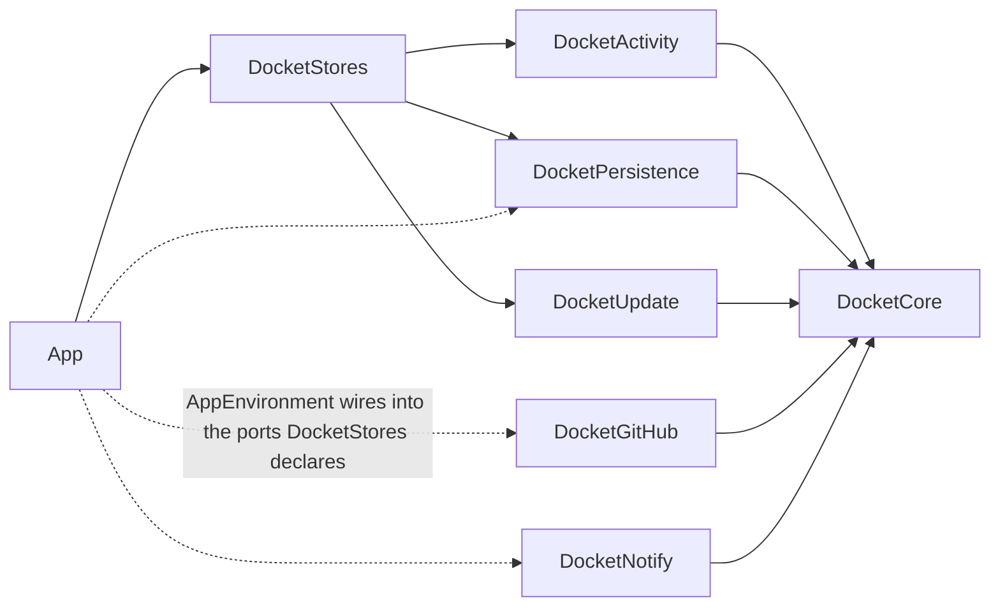

# 03 — Architecture

The shape of the app: which target does what, what may depend on what and how that is enforced, how
a poll runs, how the token is obtained, and how a build reaches the Mac. The rules the poll applies
are in [`02-activity-detection.md`](02-activity-detection.md); the files it writes are in
[`04-data.md`](04-data.md); the dependencies are in [`08-stack.md`](08-stack.md).

## 1. The central idea

**The kit decides, the app shows.** A poll produces a snapshot, a value; `DocketActivity` turns two
snapshots into a status per pull request, a count and a list of notifications, as pure functions
with no I/O and no clock of their own. Everything around them is either an adapter to something
outside the process — GitHub, the `gh` binary, the disk, Notification Center — or SwiftUI drawing
the result. A bug in what Docket tells you is therefore always reproducible as two snapshots and an
expected output, and that is the form every test of the rules takes.

## 2. Repository layout

```
apps/macos/
  App/
    Sources/
      Environment/          AppEnvironment: the composition root, builds stores with real adapters;
                            TerminalLauncher: writes the AI command script and opens it in the terminal (D-28)
      StatusBar/            The NSStatusItem, its count, the hosted popover
      Popover/              Sections, rows, chips, tag editor, account and error screens
      Settings/             The settings window, one view per section
      Updates/              Update prompt, What's New
      Support/              Login item, AppKit helpers, Snapshots (`--snapshot`)
    Resources/              Assets, Localizable.xcstrings, Info.plist values
  Packages/DocketKit/
    Sources/<one folder per target, §3>
    Tests/<one test target per target>
  Config/Version.xcconfig   Version and build number, written by release-please
  project.yml               XcodeGen spec; the .xcodeproj is generated and not committed
  Makefile                  gen, build, test, lint, format, install, ci
  scripts/                  check-imports.sh, check-coverage.sh, codesign-app.sh,
                            import-signing-identity.sh, generate-update-key.swift, sign-update.swift
  CHANGELOG.md              Bundled into the app for What's New
docs/                       The plan
scripts/ci.sh               The gate (06-engineering-practices.md §7)
scripts/check-push.sh       Refuses pushes to main and pushes of a dirty tree (06 §8)
```

The root holds `package.json`, `pnpm-lock.yaml`, `biome.json`, `commitlint.config.mjs`,
`lefthook.yml`, `release-please-config.json`, `.release-please-manifest.json`, `Brewfile`, `.nvmrc`
and `.gitleaks.toml` — tooling only, no workspace packages (D-11).

## 3. Targets and boundaries

`DocketKit` is one Swift package with one target per concern, as `LookoutKit` is.

| Target | Responsibility | Depends on |
|---|---|---|
| `DocketCore` | Domain types (`PullRequest`, `Snapshot`, `Role`, `Status`, `Event`, `Cursor`, `Tag`, `Selection`) and the ports of §7 | nothing |
| `DocketActivity` | Roles, selection, status, age, count, diff, reminders and quiet hours, folding, coalescing, the cap — every rule in `02-activity-detection.md` | `DocketCore` |
| `DocketGitHub` | GraphQL client over `URLSession`, the queries of `02` §6.1, decoding, rate-limit and SSO header parsing, `GhTokenProvider` | `DocketCore` |
| `DocketPersistence` | `config.json`, `state.json`, `cache/`: atomic writes, versioned decoding, corrupt-file handling | `DocketCore` |
| `DocketNotify` | `UNUserNotificationCenter` adapter: permission, categories, thread identifiers, click routing | `DocketCore` |
| `DocketUpdate` | Release discovery, Ed25519 and code-signature checks, installation — copied from `LookoutUpdate` (D-14) | `DocketCore` |
| `DocketStores` | `@Observable` state for the app: the `Poller` actor, `WatchStore`, `SelectionStore`, `AccountStore`, `UpdateStore` | `DocketCore`, `DocketActivity`, `DocketPersistence`, `DocketUpdate` |
| `DocketTestSupport` | Test-only: seeded generators and snapshot builders shared by the test targets (`06-engineering-practices.md` §10.2). Never linked into the app | `DocketCore` |
| `DocketCLI` | `docket-cli`: `whoami`, `poll` (one poll against your account, printing roles, statuses, events and `rateLimit.cost`), `stats` (`01-product.md` §5) | `DocketCore`, `DocketActivity`, `DocketGitHub` |



**How it is enforced.** SwiftPM refuses to compile an `import` of a target that is not a declared
dependency, so the graph above is a compiler error to violate, not a review comment. Two edges the
compiler cannot see are checked by `apps/macos/scripts/check-imports.sh`, run by `scripts/ci.sh`:

- `DocketActivity` and `DocketCore` import nothing but `Foundation`, and their sources contain none
  of `URLSession`, `FileManager`, `Process`, `UserDefaults`, `Date()`, `Date.now` or `.random`.
  Time arrives as a `now: Date` argument, and the time zone for quiet hours as a `TimeZone`
  argument; that is what makes §1 true.
- The app target never imports `DocketGitHub`, `DocketNotify` or `DocketPersistence` outside
  `App/Sources/Environment/`. Views see stores, not adapters.

`DocketStores` deliberately does not depend on `DocketGitHub` or `DocketNotify`; it is given them
through the ports, which is what lets the composition root swap them.

## 4. The poll path

`Poller` is an actor in `DocketStores`. One poll is the walk in `02-activity-detection.md` §1;
here is who does each step.

| Step | Performed by | Port |
|---|---|---|
| Discover, summarize, detail | `DocketGitHub.GraphQLClient` | `GitHubSource` |
| Team membership, hourly | `DocketGitHub.GraphQLClient` | `GitHubSource` |
| Roles, selection, status, count | `DocketActivity` | — |
| Diff, reminders, fold, coalesce, cap | `DocketActivity` | — |
| Commit snapshot, cursors, ledger | `DocketPersistence.StateStore` | `StateStoring` |
| Deliver | `StyledNotificationSink` in `App/Sources/Environment/`: Docket's cards (`05-design.md` §8.1) or `DocketNotify.UserNotificationSink`, as `config.notifications.style` says | `NotificationSink` |
| Publish to the UI | `WatchStore` on the main actor | — |

The poller publishes one immutable `WatchState` value per poll to `WatchStore`; views never observe
a half-applied poll.

## 5. Scheduling

There is no queue and no background process: the app is the process, and it polls only while it
runs.

| Trigger | Source | Effect |
|---|---|---|
| Interval | A `Task.sleep` loop in `Poller`, interval from `config.json` with ±10% jitter | Poll |
| Wake | `NSWorkspace.didWakeNotification` | Poll once |
| Sleep | `NSWorkspace.willSleepNotification` | Cancel the sleep loop until wake |
| Network | `NWPathMonitor` | Pause while unsatisfied; poll once on recovery |
| Popover opened | `StatusBar`, if the last poll is older than 30 s | Poll once |
| `⌘R` / refresh button | `Popover` | Poll once |
| Team membership | Same loop, at most hourly per organization | Refresh team slugs |
| Update check | `UpdateStore`, every 6 h, as in Lookout | Release discovery |
| Retention | Once per launch and daily (`04-data.md` §4) | Prune cursors, ledger, tags |

The rate-limit backoff in `02-activity-detection.md` §6.3 stretches or suspends the interval loop.
A poll requested while one is running is dropped.

## 6. Authentication

Docket never asks for a credential (D-02). `GhTokenProvider` implements `TokenProvider`:

1. **Locate `gh`.** The path in `config.json` if set; otherwise the first executable of
   `/opt/homebrew/bin/gh`, `/usr/local/bin/gh`; otherwise `command -v gh` run once through
   `/bin/zsh -lc` with a 3 s timeout, because a GUI app does not inherit the shell's `PATH`. The
   resolved path is cached for the launch (FR-11).
2. **Read the token.** Run `gh auth token --hostname github.com` with a 5 s timeout and an
   environment reduced to `HOME` and `PATH`, so a stray `GH_TOKEN` in a launch agent cannot
   override the signed-in account. Exit 0 with a non-empty line is a token; anything else is
   `signedOut`.
3. **Check scopes.** Every API response's `X-OAuth-Scopes` header is parsed; missing `repo` or
   `read:org` becomes `missingScopes([…])` and the popover shows the fix (FR-12).
4. **Refresh.** On a `401`, read the token again once; if it changed, retry the request; if not,
   `signedOut` (FR-14).
5. **Re-read periodically.** The token is also re-read hourly and on wake. `gh auth switch` leaves
   the old token valid, so no `401` would ever reveal it; a changed token whose `viewer.login`
   differs resets the state as `04-data.md` §2.2 describes.

The token is held in one actor property, sent only in the `Authorization` header to
`api.github.com`, and never written to disk, logged or passed to a child process (`04-data.md`
§6). The same token authorizes release downloads for the updater while the repository is private
(D-14).

**SAML.** A response with `X-GitHub-SSO: required; url=<url>` names one resource and the URL that
authorizes the token for it; `partial-results; organizations=<ids>` names organizations whose
results were left out, and their logins are resolved once with `GET /organizations/{id}`.
`AccountStore` holds the set of unauthorized organizations and the popover shows one banner per
organization (FR-13).

## 7. Ports and adapters

Ports live in `DocketCore`, except `ReleaseSource`, which lives in `DocketUpdate` with the release types it
returns. Each adapter is replaced in tests **at the edge it talks to**, never at
the port, so the code we wrote is the code under test.

| Port | Real adapter | In tests |
|---|---|---|
| `GitHubSource` | `DocketGitHub.GraphQLClient` over `URLSession` | The real client over a `URLProtocol` stub serving recorded, anonymized JSON fixtures from `Tests/DocketGitHubTests/Fixtures` |
| `TokenProvider` | `GhTokenProvider`, through a `CommandRunner` | The real provider over a `CommandRunner` that returns scripted exit codes and output |
| `StateStoring`, `ConfigStoring`, `CacheStoring` | `DocketPersistence` JSON stores | The real stores over a temporary directory |
| `NotificationSink` | `StyledNotificationSink` over `DocketNotify.UserNotificationSink` and the cards | `RecordingNotificationSink`, which keeps the composed notifications — the edge is Notification Center itself |
| `FocusHoldSink` | Not an adapter: the app target's `DocketFocusFilter` (`SetFocusFilterIntent`, App Intents) calls `NotificationStore.setHold(_:)` from `perform()` (`02` §7.5) | Tests call `setHold` directly; the intent is three lines of wiring and is checked by hand on each macOS release |
| `ReleaseSource` | `DocketUpdate.GitHubReleasesSource` | The real source over the `URLProtocol` stub, as in Lookout |

`DocketStores` tests compose these the way `AppEnvironment` does, with the stubs at the edges, and
drive polls with an injected clock. The fixtures are synthetic: no real organization, repository,
login or title is ever committed (`CLAUDE.md`).

## 8. Configuration

There are no environment variables and no build-time secrets in the app.

| Setting | Lives in | Set by |
|---|---|---|
| Bundle identifier `com.eliasjnior.docket`, minimum macOS 15 | `project.yml` | The repository |
| `DocketUpdatePublicKey` (Ed25519) | `project.yml` → `Info.plist` | `09-provider-setup.md` |
| Version and build number | `Config/Version.xcconfig` | release-please and the release workflow |
| Selection, interval, notification kinds, bots, `gh` path, tags | `config.json` | The user, in settings |

`Docket --snapshot <directory>` renders the popover, its error screens and settings sections with
synthetic data to PNG in light and dark appearance and exits, as `Lookout --snapshot` does, so a
view can be checked without screen capture.

## 9. Storage

Three locations under `~/Library/Application Support/Docket/`, written only by `DocketPersistence`:
`config.json`, `state.json` and `cache/` (D-10). Schemas, retention and what is not stored are in
[`04-data.md`](04-data.md).

## 10. Distribution and updates

| Step | What happens |
|---|---|
| Build | `make build`: XcodeGen, then `xcodebuild` |
| Release | release-please keeps a release pull request; merging it tags `macos-vX.Y.Z` and the `Release` workflow builds on a macOS runner, signs with the self-signed identity (D-15) and uploads `Docket-X.Y.Z.zip`, its `.sig` and `release.json` |
| Update | `DocketUpdate` checks every 6 h, verifies size, Ed25519 signature, minimum macOS, bundle identifier, version and designated requirement, then swaps the app and relaunches (D-14) |
| What's New | On first launch of a new version, the entries of the bundled `CHANGELOG.md` between the last shown and the running version |

A release is the only time a macOS runner is used, so a release costs about 60 of the 2000 monthly
Actions minutes while the repository is private (D-12). Signing and secrets are in
`09-provider-setup.md`.

## 11. Concurrency

The project builds in the Swift 6 language mode with complete strict concurrency checking, as
Lookout does. `Poller`, `GraphQLClient` and `GhTokenProvider` are actors; stores and views are
`@MainActor` and `@Observable`; snapshots, events and cursors are `Sendable` value types. No
`@unchecked Sendable` outside `DocketNotify`, where the `UNUserNotificationCenter` delegate is
bridged.

## 12. Observability

`os.Logger` with subsystem `com.eliasjnior.docket` and categories `poll`, `github`, `auth`,
`notify`, `persistence`, `update`. Read them with `log stream --predicate 'subsystem ==
"com.eliasjnior.docket"'`.

| Logged | Never logged |
|---|---|
| Each poll's duration, watch-set size, changed count, events by kind, notifications delivered | The token, in any form, including its prefix |
| Each query's `rateLimit.cost`, `remaining`, `resetAt` | Comment or review bodies |
| HTTP status, GraphQL error types, SSO header values | Pull request titles and logins, except with `privacy: .private` |
| Discovery time against an event's `createdAt`, for search lag (`02` §9) | Anything to a remote service: there is no crash reporter and no telemetry |

## 13. Open technical questions

None. Protecting `main` was the last one and closed with a ruleset (D-13).
