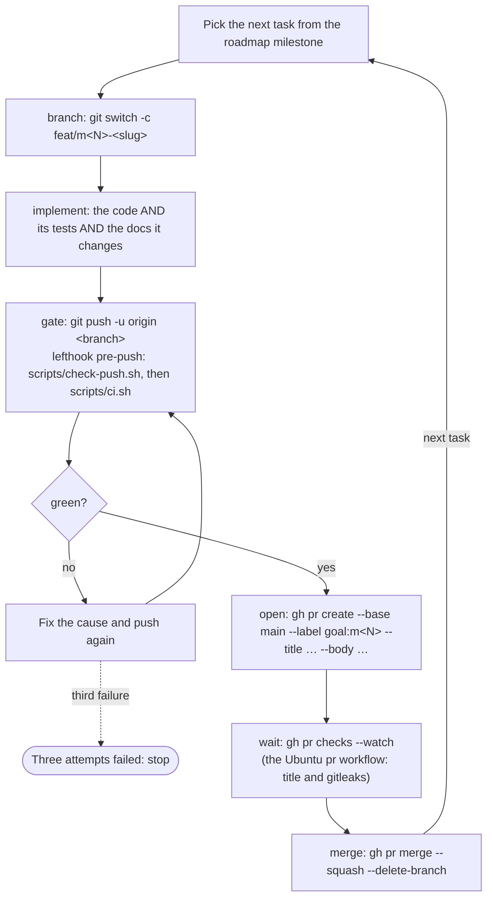

# 06 — Engineering practices

How a change gets from a roadmap task into `main`: the toolchain, branches and commits, the delivery
loop, the check suite job by job, the hooks that run it, how Docket is tested, how a release is cut,
and when a task is done. A human and an agent run the same loop; [`CLAUDE.md`](../CLAUDE.md) carries
the compressed version of §5 and §6.

## 1. Principles

1. **The gate runs before the pull request exists.** A push runs every check; a red branch never
   becomes a pull request. Nothing reaches `main` except a squash merge of a pull request.
2. **One gate, one file.** Every check lives in `scripts/ci.sh`. The hook runs it, a human runs it,
   and when the repository goes public a workflow runs it (D-12). There is no second list of checks
   to drift from the first.
3. **A skip is printed, never silent.** A job whose subject does not exist yet says so and why. A
   silent skip is indistinguishable from a pass.
4. **A behaviour arrives with the test that would fail without it, and with the document that
   describes it**, in the same pull request.
5. **Copy Lookout, then say where Docket differs.** Every difference below names its reason
   (PROJECT.md principle 7).

## 2. Toolchain

Versions are the ones pinned today, copied from Lookout so both repositories run the same tools.
They will drift; the reasoning is what should not. Why each dependency was chosen over its
alternative is in [`08-stack.md`](08-stack.md); this table says where each one runs.

| Tool | Version | Pinned in | Runs in |
|---|---|---|---|
| Xcode, with the Swift 6 toolchain | latest stable | — | `swift test`, `xcodebuild`, `swift format`, `xcrun llvm-cov` |
| `swift format` | ships with the toolchain | — | pre-commit, `scripts/ci.sh` |
| SwiftLint | 0.65.1 | `Brewfile` (unversioned), Lookout's CI image | pre-commit, `scripts/ci.sh` |
| XcodeGen | 2.46.0 | `Brewfile`, `release.yml` | `make gen`, the `Release` workflow |
| gitleaks | 8.30.1 | `Brewfile`, `pr.yml` image tag | pre-commit, `scripts/ci.sh`, the `pr` workflow |
| Node | 24 | `.nvmrc` | root tooling only |
| pnpm | 11.25.0 | `packageManager` in `package.json`, through Corepack | root tooling only |
| Biome | 2.5.15 | `package.json` | pre-commit, `scripts/ci.sh` |
| commitlint (`@commitlint/cli`, `config-conventional`) | 21.2.3 | `package.json` | commit-msg, `scripts/ci.sh`, the `pr` workflow |
| lefthook | 2.2.2 | `package.json` | installs and runs the hooks |
| `gh` | any current | — | the delivery loop; Docket's own token at runtime (D-02) |

**Homebrew versions are not pinned.** `brew bundle` installs whatever is current, so SwiftLint and
gitleaks on this Mac can move ahead of the versions above. A rule added by a SwiftLint upgrade turns
the gate red on code that did not change; the fix is to satisfy the rule or decide, in a pull
request of its own, to disable it in `.swiftlint.yml` — never an ignore comment (§6.4).

**No Turborepo** (D-11). The root `package.json` holds commitlint, Biome and lefthook as
devDependencies and delegates everything else:

| Script | Runs |
|---|---|
| `pnpm test` | `make -C apps/macos test` |
| `pnpm lint` | `biome check . && make -C apps/macos lint` |
| `pnpm format` | `biome check --write . && make -C apps/macos format` |
| `pnpm build` | `make -C apps/macos build` |
| `pnpm run ci` | `./scripts/ci.sh` |
| `prepare` | `lefthook install`, so `pnpm install` installs the hooks |

`pnpm ci` without `run` is reserved by pnpm itself and does not reach the script; the command is
`pnpm run ci`.

`apps/macos/Makefile` is Lookout's with the web steps removed:

| Target | Does |
|---|---|
| `bootstrap` | `brew bundle --file=../../Brewfile` |
| `gen` | `xcodegen generate --quiet`; the `.xcodeproj` is generated and not committed |
| `build` | `gen`, then `xcodebuild … CODE_SIGN_IDENTITY=- build` into `build/` |
| `test` | `swift test --package-path Packages/DocketKit` |
| `lint` | `swift format lint --strict --recursive` over `App`, `scripts` and the package, then `swiftlint lint --strict --quiet` |
| `format` | `swift format --in-place --recursive` over the same paths, then `swiftlint lint --fix --quiet` |
| `sign` | `scripts/codesign-app.sh` with `Docket Self-Signed Code Signing` (D-15) |
| `install` | `build sign CONFIG=Release`, quit the running app, copy to `/Applications`, re-register, open |
| `ci` | `../../scripts/ci.sh` |
| `clean` | remove `build/`, the `.xcodeproj` and the package's `.build/` |

`apps/macos/.swift-format` and `apps/macos/.swiftlint.yml` are Lookout's files with `LookoutKit`
renamed: 120-column lines, four-space indentation, `NeverUseForceTry`, `OrderedImports`, and
`force_unwrapping` and `implicitly_unwrapped_optional` opted in. Swift lines are 120 columns and
prose is 100 because those are the two formatters' widths.

## 3. Repository and branches

`git@github.com:eliasjnior/docket.git`, private (D-04). **`main` is the only merge target**: every
pull request is opened against it, there is no second remote and no fork, and nothing is pushed
to it directly — lefthook refuses the push on this machine (§8), and a ruleset refuses it on GitHub
if the account plan allows one (D-13).

**In this repository the agent drives the whole pull request loop** — branch, push,
`gh pr create`, wait, `gh pr merge --squash --delete-branch` — overriding any global rule about
opening pull requests by hand, exactly as Lookout's `CLAUDE.md` does. The loop is §5; the
conditions under which it may merge without a human are §6.3.

| Branch | For | Example |
|---|---|---|
| `feat/m<N>-<slug>` | A task of milestone `M<N>` in [`07-roadmap.md`](07-roadmap.md) | `feat/m1-status-precedence` |
| `fix/<slug>` | A defect, with the test that reproduces it | `fix/unknown-mergeable-flip` |
| `chore/<slug>` | Dependencies, tooling, renames with no behaviour change | `chore/bump-biome` |
| `ci/<slug>` | `scripts/`, hooks, workflows | `ci/coverage-gate` |
| `docs/<slug>` | A change to `docs/` or `PROJECT.md` alone | `docs/notification-copy` |

Branches are short-lived: one task, one branch, deleted by the merge. Squash merge is the only
merge method, so the pull request title becomes the one commit on `main` and the branch's own
commits are not kept.

## 4. Commits

Conventional Commits, checked by commitlint on every commit (`commit-msg`), over every commit of
the branch (`scripts/ci.sh`) and on the pull request title (the `pr` workflow). The title is the
one that matters: squash merge makes it the commit on `main`, and release-please reads it to choose
the version bump and write the changelog (§11).

```js
// commitlint.config.mjs
export default {
  extends: ["@commitlint/config-conventional"],
  rules: {
    "scope-enum": [
      2,
      "always",
      [
        "macos", "core", "activity", "github", "persistence", "notify", "stores",
        "update", "cli", "ci", "deps", "release", "repo", "docs",
      ],
    ],
  },
};
```

**Scopes are an error here, not Lookout's warning.** A warning passes the `pr` workflow, so a
mistyped scope would reach `main` and the changelog; with one app and a fixed target list there is
no scope a contributor needs that is not on it. Scope is optional — a change that spans targets
leaves it out rather than picking one.

| Scope | Paths |
|---|---|
| `macos` | `apps/macos/App/`, `project.yml`, `Makefile`, the app as a whole |
| `core` | `DocketCore` |
| `activity` | `DocketActivity` |
| `github` | `DocketGitHub` |
| `persistence` | `DocketPersistence` |
| `notify` | `DocketNotify` |
| `stores` | `DocketStores` |
| `update` | `DocketUpdate` |
| `cli` | `DocketCLI` (`docket-cli`) |
| `ci` | `scripts/`, `apps/macos/scripts/`, `lefthook.yml`, `.github/workflows/` |
| `deps` | `package.json`, `pnpm-lock.yaml`, `Brewfile`, `Package.resolved` |
| `release` | release-please's own pull requests and configuration |
| `repo` | root files that are none of the above: `.gitignore`, `biome.json`, `.gitleaks.toml` |
| `docs` | `docs/`, `PROJECT.md`, `CLAUDE.md`, `README.md` |

`feat` bumps the minor version and `fix` and `perf` the patch; `docs`, `ci`, `chore`, `test`,
`refactor` and `build` cut no release and are hidden from the changelog.

## 5. The delivery loop

One task in, one merged commit out. Repeat until the milestone's **Done when** in
[`07-roadmap.md`](07-roadmap.md) is true.



Nothing in this loop is optional and nothing in it is reordered. In particular: **the gate runs
before the pull request exists**, so a red branch never becomes somebody's review.

### 5.1 Implement

A task is done when all three of these are true, not one:

1. **The code.** Inside the current declared goal, and nothing else — a drive-by refactor in an
   unrelated file is a separate pull request.
2. **The tests.** The layer the change belongs to, per §10.1. A behaviour described in `docs/`
   arrives with the test that would fail if it were dropped; a new rule in
   `02-activity-detection.md` arrives with a new row in its §8 and the test that row names.
3. **The documents.** A change to behaviour described in `docs/` updates that document **in the
   same pull request**. Documentation drift is the failure mode of a plan this detailed.

### 5.2 Size budget

**Under about 400 changed lines, excluding lockfiles, fixtures and snapshots.** If it does not fit,
it is more than one pull request — stack them, each one green on its own. Measured as:

```sh
git diff --shortstat "$(git merge-base origin/main HEAD)" -- . \
  ':!pnpm-lock.yaml' ':!**/Package.resolved' ':!**/Fixtures/**' ':!**/*.png'
```

## 6. Pull requests

### 6.1 Open

```sh
gh pr create --base main --label "goal:m<N>" \
  --title "<type>(<scope>): <subject>" \
  --body "$(cat <<'BODY'
## What changed
<one paragraph>

## Why
Milestone M<N>, <FR-xx>. <link to the document section this implements>

## How it was verified
<the tests added, and the command that proves it>

## Risk if this is wrong
<what breaks, and how it would be noticed>
BODY
)"
```

The title follows Conventional Commits, because squash merge makes it the commit on `main` (§4).
Four sections in the body, always the same four — the fourth is the one people skip and the one
that catches things. "How it was verified" names the test cases, not "tests pass"; for a view it
names the `Docket --snapshot` output that was looked at (§10.5).

Labels: `goal:m<N>` on every task pull request, so a milestone's work is one query;
`needs-human` when §6.3 or §6.4 stops the loop.

### 6.2 Wait, then merge

```sh
gh pr checks --watch     # returns non-zero if any check fails
gh pr merge --squash --delete-branch
```

`gh pr checks --watch` waits on the Ubuntu `pr` workflow only (§9): the pull request title and
gitleaks. The Swift checks already ran, on this machine, before the push (§7).

### 6.3 Auto-merge

**Auto-merge is allowed only when every one of these holds:**

- [ ] the change is inside the current declared goal;
- [ ] every required check passes — the `pre-push` gate was green on the pushed commit, and the
      `pr` workflow is green;
- [ ] there is no `needs-human` label;
- [ ] no file is touched under `.github/workflows/`, `scripts/ci.sh`, `scripts/check-push.sh`,
      `lefthook.yml`, `apps/macos/scripts/check-imports.sh`, `apps/macos/scripts/check-coverage.sh`,
      the signing scripts (`codesign-app.sh`, `import-signing-identity.sh`, `sign-update.swift`,
      `generate-update-key.swift`), the signing settings or `DocketUpdatePublicKey` in
      `project.yml`, or anything holding secrets;
- [ ] no on-disk format changed: no file's top-level `version` in
      [`04-data.md`](04-data.md) §1 moved, and no existing version decodes differently;
- [ ] no public type in `DocketCore` or `DocketActivity` changed;
- [ ] `PROJECT.md` §6, the decision register, did not change;
- [ ] the diff is within the size budget (§5.2).

If any condition fails: apply `needs-human`, write why in a comment, and stop. **Do not work
around the condition.** A human merging it is the point.

The files in the fourth item are the ones that decide what the gate checks or what a release
trusts; a change to them that merged itself could switch off the check that would have caught it.
The on-disk item is Docket's equivalent of a destructive migration: a `state.json` the new version
misreads costs a round of re-baselining at best and duplicate notifications at worst (NFR-05).

### 6.4 When a check fails

Read the failing job. Fix the actual cause. Push again.

**Three attempts maximum**, then label `needs-human`, write down what was tried and what was
learned, and stop. Three failures on the same check is evidence the problem is not where you are
looking.

Never "fix" a check by:

- deleting a test, or skipping it, or marking it `.todo`;
- loosening a lint rule, or adding an ignore comment;
- widening a type, or adding `any`, or a non-null assertion;
- pushing with `--no-verify`;
- re-running the job hoping for a different result.

Each of those converts a caught problem into an uncaught one, which is strictly worse than the red
check.

In Swift those are, among others: `.disabled(…)` or `withKnownIssue` on a test;
`// swiftlint:disable`, `// swift-format-ignore`, or a rule removed from `.swiftlint.yml`; `Any`,
`!`, `try!`, `as!`, `@unchecked Sendable` or `nonisolated(unsafe)` added to make the compiler stop;
lowering a threshold in `check-coverage.sh`; adding a path to `check-imports.sh`'s allowances.

### 6.5 Continue, or stop

Take the next task and run the loop again. The milestone is finished when its **Done when**
sentence is true — verified, not assumed — at which point:

- update the **What exists today** table in `CLAUDE.md` in the same pull request as the last task;
- report the milestone as done, with the evidence that its **Done when** holds;
- merge the open release-please pull request (§11);
- start the next milestone.

Stop the loop and come back to the user when: the milestone is done, a `needs-human` label was
applied, a decision in the register turns out to be wrong, or the work needs a `D-xx` that does not
exist. Those four, and nothing else — in particular, not "this task was hard".

## 7. The check suite

### 7.1 Where it runs, and what that costs

**The Swift checks run only on this machine, behind lefthook's `pre-push` (D-12).** Hosted macOS
minutes on a private repository count ten times against GitHub Free's 2000 monthly minutes, so a
6-minute build-and-test on every pull request would exhaust the allowance in about thirty pull
requests. GitHub Actions runs only the Ubuntu `pr` workflow and the `Release` workflow (§9).

**What is lost is real.** The Swift checks are enforced by the author's own machine, so
`git push --no-verify` is the way past the only gate there is, and a green pull request proves only
that whoever pushed it did not use that flag. Nothing on GitHub can tell a branch that passed
`scripts/ci.sh` from one that skipped it. That is why `--no-verify` is in the never-do list (§6.4)
and in `CLAUDE.md`, and why the hook refuses a push of anything other than a clean `HEAD` (§8):
the gate checks the working tree, so it must be the tree being pushed.

**Revisit when** the repository goes public (D-04): the `pr` workflow gains a `macos-26` job that
runs `CI_FAST= ./scripts/ci.sh`, as Lookout's `macos` job runs `make ci`, the job becomes a required
check, and `pre-push` stays as the same script run earlier.

### 7.2 `scripts/ci.sh`

One file holds every check job. It **runs every job before reporting**, because a script that exits
on the first failure makes you push four times to find four problems, and it **skips rather than
fails** for a job whose subject does not exist yet — printing the reason — so the same script is
correct from `M0` to the last milestone and the suite grows by things being built rather than by
anyone editing it.

```bash
#!/usr/bin/env bash
# Every check Docket has. Run by lefthook's pre-push, and by hand as `pnpm run ci`.
# CI_FAST=1 omits the xcodebuild build of the app.
set -uo pipefail
cd "$(git rev-parse --show-toplevel)"

macos=apps/macos
kit=$macos/Packages/DocketKit

failed=()
run() { # run <name> <command...>
  local name="$1"; shift
  printf '\n\033[1m── %s\033[0m\n' "$name"
  if "$@"; then
    printf '\033[32m   ok\033[0m\n'
  else
    printf '\033[31m   FAILED\033[0m\n'
    failed+=("$name")
    return 1
  fi
}
skip() { printf '\n\033[1m── %s\033[0m\n\033[33m   skipped — %s\033[0m\n' "$1" "$2"; }

swift_format_lint() {
  local paths=() p
  for p in App scripts Packages/DocketKit/Sources Packages/DocketKit/Tests \
    Packages/DocketKit/Package.swift; do
    [ -e "$macos/$p" ] && paths+=("$p")
  done
  (cd "$macos" && swift format lint --strict --recursive "${paths[@]}")
}
swiftlint_lint() { (cd "$macos" && swiftlint lint --strict --quiet); }

# The branch's own commits: everything since it left origin/main. No fetch, so a push stays offline.
base=""
if git rev-parse --verify --quiet origin/main >/dev/null; then
  base=$(git merge-base origin/main HEAD)
fi

run "biome" pnpm exec biome ci .

if [ -z "$(git ls-files -- '*.swift')" ]; then
  skip "swift-format" "no Swift sources yet"
  skip "swiftlint" "no Swift sources yet"
else
  run "swift-format" swift_format_lint
  run "swiftlint" swiftlint_lint
fi

if [ -x "$macos/scripts/check-imports.sh" ]; then
  run "target boundaries" "$macos/scripts/check-imports.sh"
else
  skip "target boundaries" "$macos/scripts/check-imports.sh does not exist yet"
fi

if [ -n "${CI_FAST:-}" ]; then
  skip "app build" "CI_FAST=1"
elif [ ! -f "$macos/project.yml" ]; then
  skip "app build" "no $macos/project.yml yet"
else
  run "app build" make -C "$macos" build
fi

if [ ! -f "$kit/Package.swift" ]; then
  skip "kit tests" "no $kit/Package.swift yet"
  skip "coverage" "no kit yet"
elif run "kit tests" swift test --package-path "$kit" --enable-code-coverage; then
  if [ -x "$macos/scripts/check-coverage.sh" ]; then
    run "coverage" "$macos/scripts/check-coverage.sh"
  else
    skip "coverage" "$macos/scripts/check-coverage.sh does not exist yet"
  fi
else
  skip "coverage" "kit tests failed, so there is no profile to read"
fi

if [ -z "$base" ]; then
  skip "commit messages" "no origin/main yet"
  skip "secrets in commits" "no origin/main yet"
else
  run "commit messages" pnpm exec commitlint --from "$base" --to HEAD --verbose
  run "secrets in commits" gitleaks git --log-opts="$base..HEAD" --redact --no-banner .
fi

if [ ${#failed[@]} -gt 0 ]; then
  printf '\n\033[31m%d job(s) failed: %s\033[0m\n' "${#failed[@]}" "${failed[*]}"
  exit 1
fi
printf '\n\033[32mall checks passed\033[0m\n'
```

### 7.3 The jobs

| Job | Command | Fails when | Skips when |
|---|---|---|---|
| `biome` | `pnpm exec biome ci .` | A JSON or JS file is unformatted or breaks a recommended rule | Never; `package.json` exists from `M0` |
| `swift-format` | `swift format lint --strict --recursive` over `App`, `scripts`, the package | Any formatting difference from `.swift-format` | No tracked `.swift` file |
| `swiftlint` | `swiftlint lint --strict --quiet` | Any warning (`--strict` promotes them) | No tracked `.swift` file |
| `target boundaries` | `apps/macos/scripts/check-imports.sh` | `DocketActivity` or `DocketCore` import anything but `Foundation` or touch the clock, disk, network, processes or randomness; the app imports an adapter outside `Environment/` (`03-architecture.md` §3) | The script does not exist yet |
| `app build` | `make -C apps/macos build`: XcodeGen, then `xcodebuild build` | The app target does not compile in Swift 6 with complete concurrency checking | `CI_FAST=1`, or no `project.yml` yet |
| `kit tests` | `swift test --package-path apps/macos/Packages/DocketKit --enable-code-coverage` | Any test fails | No `Package.swift` yet |
| `coverage` | `apps/macos/scripts/check-coverage.sh` | NFR-09: `DocketActivity` < 90% lines, or `DocketKit` < 75% lines | The script does not exist yet, or `kit tests` failed |
| `commit messages` | `commitlint --from <merge-base> --to HEAD` | Any commit on the branch breaks §4 | No `origin/main` yet |
| `secrets in commits` | `gitleaks git --log-opts=<merge-base>..HEAD` | A token, key or credential pattern in any commit on the branch | No `origin/main` yet |

`CI_FAST=1 git push` drops the only slow job that the tests do not already cover — the app target
holds no logic (§10.1), so what it skips is compilation of wiring and views. It is for a push that
touches only the kit, a document or a script; a push that touches `App/` runs the full suite.

**What the suite does not check** is in §10.6, with the reason for each gap.

### 7.4 `apps/macos/scripts/check-coverage.sh`

NFR-09 is a threshold that fails the gate, so it is a script, not a number in a document:

```bash
#!/usr/bin/env bash
# Enforces NFR-09 over the profile `swift test --enable-code-coverage` just wrote.
set -euo pipefail
kit="$(cd "$(dirname "$0")/../Packages/DocketKit" && pwd)"
bin="$(swift build --package-path "$kit" --show-bin-path)"
profile="$bin/codecov/default.profdata"
binary="$bin/DocketKitPackageTests.xctest/Contents/MacOS/DocketKitPackageTests"

# percent <path>: line coverage of the sources under <path>, from llvm-cov's TOTAL row
# (column 8 is lines, column 9 missed lines).
percent() {
  xcrun llvm-cov report "$binary" -instr-profile "$profile" "$1" \
    | awk '$1 == "TOTAL" && $8 > 0 { printf "%.2f", ($8 - $9) * 100 / $8 }'
}

status=0
check() { # check <label> <path> <minimum>
  local got; got=$(percent "$2")
  if [ -z "$got" ]; then
    echo "$1: no coverage data for $2"; status=1
  elif awk -v g="$got" -v m="$3" 'BEGIN { exit !(g < m) }'; then
    echo "$1: $got% lines, below $3%"; status=1
  else
    echo "$1: $got% lines (minimum $3%)"
  fi
}

check "DocketActivity" "$kit/Sources/DocketActivity" 90
check "DocketKit" "$kit/Sources" 75
exit $status
```

Only `Sources/` is measured, so test code never counts toward its own coverage. The kit-wide 75%
includes `DocketNotify` and `DocketUpdate`, whose system-facing halves are thin and partly
untestable (§10.6); the threshold is set where the testable targets carry it. **Revisit if**
`DocketKit` sits above 85% for a whole milestone — then the floor rises to meet it.

## 8. Hooks

lefthook, installed by `pnpm install` through `prepare`. Lookout's file, with two changes: Biome's
glob drops the web file types Docket has none of, and `pre-push` runs the whole gate instead of
`turbo run test --affected`.

```yaml
# lefthook.yml
pre-commit:
  parallel: true
  jobs:
    - name: biome
      glob: "*.{js,mjs,cjs,json,jsonc}"
      run: pnpm exec biome check --no-errors-on-unmatched --files-ignore-unknown=true {staged_files}
    - name: swift-format
      root: apps/macos/
      glob: "*.swift"
      run: swift format lint --strict {staged_files}
    - name: swiftlint
      root: apps/macos/
      glob: "*.swift"
      run: swiftlint lint --strict --quiet {staged_files}
    - name: gitleaks
      run: gitleaks git --staged --redact --no-banner

commit-msg:
  jobs:
    - name: commitlint
      run: pnpm exec commitlint --edit {1}

pre-push:
  piped: true
  jobs:
    - name: push guard
      use_stdin: true
      run: ./scripts/check-push.sh
    - name: ci
      run: ./scripts/ci.sh
```

`pre-commit` is a fast subset over staged files only: format, lint and secrets, in seconds.
`pre-push` is the gate. `piped: true` makes the guard's refusal stop the push before the suite
spends minutes on it.

```bash
#!/usr/bin/env bash
# scripts/check-push.sh — run by lefthook's pre-push before scripts/ci.sh.
# stdin carries one line per ref: <local ref> <local sha> <remote ref> <remote sha>
set -euo pipefail
head=$(git rev-parse HEAD)
zero=0000000000000000000000000000000000000000

while read -r local_ref local_sha remote_ref _; do
  if [ "$remote_ref" = "refs/heads/main" ]; then
    echo "refusing to push to main: open a pull request (docs/06-engineering-practices.md §6)" >&2
    exit 1
  fi
  [ "$local_sha" = "$zero" ] && continue # deleting a remote branch
  if [ "$local_sha" != "$head" ]; then
    echo "refusing to push $local_ref: scripts/ci.sh checks HEAD, and $local_ref is not HEAD" >&2
    exit 1
  fi
done

if [ -n "$(git status --porcelain)" ]; then
  echo "refusing to push with uncommitted changes: scripts/ci.sh would check files" \
    "the push does not contain" >&2
  exit 1
fi
```

**The guard is D-13's local enforcement.** A push to `refs/heads/main` from this machine is
refused whatever the account plan allows on GitHub; merges reach `main` through
`gh pr merge`, which is GitHub's side, and release-please's commits are made by the `Release`
workflow, so nothing legitimate is blocked. The other two refusals exist because the suite runs
over the working tree: without them, an uncommitted fix or a push of another branch would let a
green gate vouch for commits it never saw. Like everything else in the hook, `--no-verify` skips
it (§7.1).

## 9. GitHub Actions

Two workflows, plus `.github/dependabot.yml` proposing npm and Actions updates as ordinary pull
requests through the loop. Neither workflow runs Swift on a pull request (D-12).

### 9.1 `pr` — the pull request title and secrets

```yaml
# .github/workflows/pr.yml
name: pr

on:
  pull_request:
    types: [opened, edited, synchronize, reopened]

concurrency:
  group: pr-${{ github.head_ref }}
  cancel-in-progress: true

permissions:
  contents: read

jobs:
  pr-title:
    runs-on: ubuntu-latest
    timeout-minutes: 5
    steps:
      - uses: actions/checkout@v7
      - uses: pnpm/action-setup@v6
      - uses: actions/setup-node@v7
        with:
          node-version-file: .nvmrc
          cache: pnpm
      - run: pnpm install --frozen-lockfile
      - name: commitlint
        env:
          TITLE: ${{ github.event.pull_request.title }}
        run: printf '%s\n' "$TITLE" | pnpm exec commitlint --verbose

  secrets:
    runs-on: ubuntu-latest
    timeout-minutes: 5
    steps:
      - uses: actions/checkout@v7
        with:
          fetch-depth: 0
      - name: gitleaks
        run: >-
          docker run --rm -v "$PWD:/repo" ghcr.io/gitleaks/gitleaks:v8.30.1
          git /repo --config /repo/.gitleaks.toml --redact --no-banner
```

**Commitlint over Lookout's `action-semantic-pull-request`.** The action has its own list of types
and scopes in workflow inputs; commitlint reads `commitlint.config.mjs`, so the title on GitHub is
checked by exactly the rules the `commit-msg` hook applies, and a scope added to §4 is added in one
place. The title travels through an environment variable, never interpolated into the script,
because a pull request title is attacker-controlled text on a public repository and the workflow
should already be written as if it were one (`04-data.md` §6). `edited` is in the trigger types so
a retitled pull request is re-checked. gitleaks scans the whole history, as Lookout's does, which
costs seconds at this size and also catches a secret added and removed inside the branch.

Both jobs run at 1× on Ubuntu, a few minutes of the monthly allowance per week. When D-13 closes
with a ruleset, `pr-title` and `secrets` are its required status checks.

### 9.2 `Release`

Lookout's `release.yml` with `Lookout` renamed and the web steps removed:

| Job | Runner | Runs when | Does |
|---|---|---|---|
| `release-please` | `ubuntu-latest` | Every push to `main` | Keeps the release pull request current; approves the `pr` runs on it, since runs on a pull request opened by `GITHUB_TOKEN` wait for approval |
| `macos` | `macos-26` | Only when `release-please` created a release | XcodeGen 2.46.0, `make build CONFIG=Release BUILD_NUMBER=<run number>`, sign, `ditto` into `Docket-X.Y.Z.zip`, `sign-update.swift` into `.sig`, `release.json`, `gh release upload` |

The macOS runner exists only in this job, so the only ten-times minutes Docket spends are about 60
per release (`03-architecture.md` §10).

## 10. Testing

Swift Testing (`import Testing`, `@Test`, `#expect`), as every Lookout test target uses. XCTest is
not used: Swift Testing's parameterized `@Test(arguments:)` is what turns the worked-example table
of `02-activity-detection.md` §8 into one test per row, and mixing two frameworks in one package
buys nothing.

**The principle underneath: do not mock our own modules.** Every adapter is replaced at the edge
it talks to — the network, the `gh` process, the file system, Notification Center — never at the
port, so the code we wrote is the code under test (`03-architecture.md` §7). If a test needs to mock
something we wrote, the boundary is wrong, and the fix is to the boundary.

### 10.1 Layers

| Layer | Tool | Runs against | In the default run | Fixtures | Properties that must always hold |
|---|---|---|---|---|---|
| `DocketActivityTests` | Swift Testing | Pure functions over synthetic `Snapshot` values and a fixed `now` | Yes | Built in code by small builders; the rows of `02` §8 verbatim, one `@Test` argument each | §10.2, all but the last two |
| `DocketCoreTests` | Swift Testing | Domain types: tag normalization (FR-81), identity, `Codable` round trips | Yes | In code | A tag that normalizes once normalizes to itself |
| `DocketGitHubTests` | Swift Testing | The real `GraphQLClient` over a `URLProtocol` stub; the real `GhTokenProvider` over a scripted `CommandRunner` | Yes | Recorded, anonymized JSON in `Tests/DocketGitHubTests/Fixtures/`, one file per query and response shape, including `X-GitHub-SSO` and `X-OAuth-Scopes` headers | Every recorded response decodes; an unknown enum value decodes to `unknown`, never a throw |
| `DocketPersistenceTests` | Swift Testing | The real stores over a fresh temporary directory per test | Yes | Hand-written JSON for each `version` in `04-data.md` §1, plus truncated and corrupt files | Write then read is the identity; a file with a higher `version` is never overwritten |
| `DocketNotifyTests` | Swift Testing | Composition of content, `threadIdentifier` and click routing, recorded by `RecordingNotificationSink` | Yes | In code | One thread identifier per repository (FR-54) |
| `DocketUpdateTests` | Swift Testing | Copied from `LookoutUpdateTests`: the real verifier and release source over the `URLProtocol` stub | Yes | Test key pair generated in the test; synthetic `release.json` | A tampered byte or signature is always rejected |
| `DocketStoresTests` | Swift Testing | Stores composed as `AppEnvironment` composes them, with the stubs above at the edges, the real persistence over a temp directory, and an injected clock | Yes | The `DocketGitHubTests` fixtures, sequenced into polls | The last two of §10.2 |
| `DocketCLI` | — | Wiring of kit functions to arguments | — | — | Tested through the targets it calls |
| App target | `Docket --snapshot` | Views with synthetic data | No | `App/Sources/Support/Snapshots.swift` | None — it holds no logic (§10.5) |

**The app target holds no logic.** If a behaviour needs a window to be tested, it is in the wrong
target (PROJECT.md principle 5); the fix is to move it into a store or into `DocketActivity`, not to
add a UI test.

### 10.2 Properties

Examples prove the cases somebody thought of; properties prove the rules hold over inputs nobody
wrote down. Each property below is asserted over generated inputs: 500 cases per property from a
seeded generator, with the seed fixed in the test and printed on failure, so a red run
reproduces exactly. A failing seed becomes a named example in `02-activity-detection.md` §8 before
it is fixed.

| Property | Over | Requirement |
|---|---|---|
| No event is produced for an item whose author is the viewer | Generated snapshot pairs where the viewer authored some reviews, comments and requests | FR-56 |
| No bot author produces an event unless its login is in `botAllowlist` | Generated authors, typed `Bot` or ending `[bot]`, with random allowlists | FR-57, D-16 |
| One poll yields at most 5 notifications | Generated event sets of 0 to 200 events across 1 to 30 repositories | FR-55, `02` §7.3 |
| Coalescing loses no repository: every repository with an event appears in a notification or in the overflow line | Same | `02` §7.1, §7.3 |
| The diff of a snapshot with itself is empty | Generated snapshots | `02` §5 |
| Each pull request has exactly one role, and it follows `authored` > `reviewRequested` > `involved` | Generated involvement facts | FR-23 |
| Status is total: every summary maps to exactly one status | **Every** combination of the inputs of `02` §3.1 — the input enums are finite, so this one is exhaustive rather than sampled | FR-30 |
| A draft is never counted in "needs you" | Generated snapshots with drafts | `02` §4 |
| Delivery is at most once across a simulated crash: for a crash injected at every step between computing events and committing state, the next launch over the same directory never delivers an event the previous one delivered | Generated poll sequences, in `DocketStoresTests` | FR-58, NFR-05, `02` §5.6 |
| No reminder is due inside quiet hours, and no poll produces more than one reminder per pull request | Generated request times, poll sequences with gaps, intervals, windows crossing midnight and time zones with a DST changeover | FR-65, FR-67, `02` §5.7 |
| A restart never re-notifies: polling, discarding the stores, rebuilding them over the same directory and polling the same snapshot delivers nothing | Generated snapshots | FR-58 |

No property-testing library: the generators are a seeded `RandomNumberGenerator` and a few
builders, about a hundred lines, kept in a test-only `DocketTestSupport` target that
`DocketActivityTests` and `DocketStoresTests` both depend on. SwiftCheck was the alternative; its
shrinking is the feature worth having, and it loses because it is a dependency with irregular
releases for a test suite whose failing cases are turned into named examples by hand anyway.
`check-imports.sh` forbids `.random` in `DocketActivity` sources, not in tests, and the generator
is seeded regardless.

### 10.3 Fixtures

**Synthetic, never real.** Logins are `you`, `ana`, `bruno`, `carla`, `dave`; organizations and
repositories are `acme/api`, `acme/web` and the like; titles are invented. No real login,
organization, repository name, title, node ID or token is ever committed, even though the
repository is private (`04-data.md` §6). Recorded GraphQL responses are anonymized before they are
committed: every identifying string replaced, node IDs regenerated, and the file read in full by
the author of the pull request that adds it. gitleaks catches tokens, not names; the reading is
what catches names.

Fixtures are excluded from the size budget (§5.2) and from Biome (`biome.json`), because they are
data shaped by GitHub, not code shaped by us.

### 10.4 The clock

`DocketActivity` takes `now: Date` as an argument and has no clock (`03-architecture.md` §3).
`DocketStores` takes a clock that tests advance by hand, so the interval loop, the 30 s popover
refresh, hourly team refresh and 30-day retention are driven in milliseconds without `Task.sleep`
in a test. A test that sleeps on the real clock is a defect: it is slow when it passes and flaky
when the machine is busy.

### 10.5 Checking UI

Screen capture is not available to agents. `Docket --snapshot <directory>` — the built binary in
`Contents/MacOS` — renders the popover, its error screens and the settings sections with synthetic
data to PNG in light and dark appearance, then exits (`03-architecture.md` §8). A pull request that
changes a view runs it and looks at the output, and says so in "How it was verified"; a view that
cannot be rendered this way gets a case in `App/Sources/Support/Snapshots.swift` in the same pull
request. The PNGs are not committed and not diffed: pixel comparison across macOS versions fails on
font rendering more often than on bugs. Review against the checklist in
[`05-design.md`](05-design.md) is what the snapshot is for.

### 10.6 What is not tested, and why

| Not tested automatically | Why | Checked instead by |
|---|---|---|
| The real GitHub API | A test against it needs a token and an account with pull requests in known states, and would fail on GitHub's search lag | `docket-cli poll` against your own account at the end of every milestone that touches `DocketGitHub`, and its printed `rateLimit.cost` against NFR-01 and NFR-02 |
| The real `gh` binary | Its output format is the contract; the scripted `CommandRunner` covers every exit path FR-10 to FR-14 name | `docket-cli whoami` |
| Delivery by Notification Center | It needs a signed app with granted permission and shows on screen | `make install` and the notification of `02` §8 row 2, by hand |
| Views | No logic lives there (§10.1) | `Docket --snapshot` (§10.5) |
| NFR-06 popover latency, NFR-07 idle cost, NFR-08 first data | Wall-clock and resident memory on a shared machine are noise in a unit test | Instruments and Activity Monitor on a Debug build with 100 pull requests, once per milestone that touches the poll path or the popover |
| Code signing and the update swap | Needs the certificate in a keychain | The first update after each release, installed over the previous one |

## 11. Releases and signing

release-please, as in Lookout: one component, `macos`, at path `apps/macos`, tagged
`macos-vX.Y.Z`, with its changelog at `apps/macos/CHANGELOG.md` — the same file the app bundles
for What's New (FR-94). The configuration is Lookout's `release-please-config.json` with
`package-name` `Docket for macOS`, `initial-version` `0.1.0`, `bump-minor-pre-major`, the same
changelog sections, and `Config/Version.xcconfig` as its only extra file, since Docket has no
`apps/macos/package.json` (D-11).

The flow:

1. Task pull requests are squash-merged into `main`.
2. The `Release` workflow keeps one release pull request up to date with the next version and the
   changelog entries since the last tag.
3. **At the end of a milestone, the release pull request is merged** (§6.5). That tags the commit
   and publishes a GitHub Release.
4. The `macos` job builds, signs and uploads `Docket-X.Y.Z.zip`, `Docket-X.Y.Z.zip.sig` and
   `release.json` (§9.2), and `DocketUpdate` on installed copies finds it within 6 hours (D-14).

The release pull request touches `CHANGELOG.md`, `version.txt`, `.release-please-manifest.json`
and `Config/Version.xcconfig` only, so it meets §6.3 and is merged by the same loop. If it ever
touches anything else, the configuration changed and a human looks.

**Signing** is a self-signed certificate, `Docket Self-Signed Code Signing` (D-15); archives carry
an Ed25519 signature checked against `DocketUpdatePublicKey` (D-14). How to create the certificate
and the key pair, import them locally, store them as repository secrets and rotate them is in
[`09-provider-setup.md`](09-provider-setup.md), and nowhere else.

## 12. Local development

From a fresh clone, on macOS 15 or later with Xcode installed:

```sh
brew bundle                      # xcodegen, swiftlint, gitleaks
corepack enable                  # pnpm at the version in package.json
pnpm install                     # root tooling; `prepare` installs the lefthook hooks
make -C apps/macos gen build     # generate the Xcode project and build the app, ad-hoc signed
make -C apps/macos test          # the kit's tests
make -C apps/macos install       # Release build, signed, copied to /Applications and opened
```

`make install` needs the signing identity in the login keychain; without it, `codesign-app.sh`
fails and `make build` with its ad-hoc signature is what runs (`09-provider-setup.md`). An ad-hoc
build gets its own notification permission and Keychain prompts, separate from the installed app's,
because its designated requirement differs.

For a live check against GitHub without the app:

```sh
swift run --package-path apps/macos/Packages/DocketKit docket-cli poll
```

It polls once with your `gh` token and prints roles, statuses, the events the diff would produce and
each query's `rateLimit.cost`. It reads your real pull requests, so its output is never pasted into
a pull request, an issue or a fixture (§10.3).

Logs: `log stream --predicate 'subsystem == "com.eliasjnior.docket"'` (`03-architecture.md` §12).

## 13. Definition of done for a task

A task is done when every one of these is true:

- [ ] The code is inside the task's goal and the milestone's scope, and nothing else changed.
- [ ] The tests for its layer (§10.1) exist and would fail without the change; a new rule has a row
      in `02-activity-detection.md` §8 and its test.
- [ ] Every document describing the changed behaviour is updated in the same pull request.
- [ ] `scripts/ci.sh` was green on the pushed commit, with every skip one whose reason is still
      true — a job that should run and printed "skipped" is a failure.
- [ ] A view change was rendered with `Docket --snapshot` and looked at.
- [ ] The pull request has a Conventional Commit title, the four body sections and `goal:m<N>`.
- [ ] The `pr` workflow is green, and the pull request was squash-merged with its branch deleted —
      or it carries `needs-human` with the reason written down.
- [ ] If it was the milestone's last task: `CLAUDE.md`'s **What exists today** is updated and the
      release pull request is merged.
