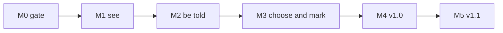

# 07 — Roadmap

The order in which Docket is built, what each milestone delivers and how anyone can tell it is
done, the tasks that must not be forgotten after launch, and the risks with the mechanism that
answers each. There are no dates: a milestone starts when the one before it is done.

## 1. How the milestones work

The order is strict. M1 needs the gate and the empty targets of M0. M2 diffs the snapshots M1
produces. M3 comes after M2 because the selection applies to notifications as well as to the list
(FR-74), and its worked example needs cursors (`02-activity-detection.md` §8 #18). M4 adds nothing
to detection; it makes the app installable and maintainable by someone who did not build it.

Each milestone is a series of pull requests, each of them one task below and each through the
delivery loop of `06-engineering-practices.md`. A task names the `FR-xx` / `NFR-xx` it delivers;
the requirement is delivered when the test named in the document that specifies it passes. The
milestone is done when its **Done when** sentence is true — verified on a real account, not
assumed — and the pull request with its last task also updates the **What exists today** table in
`CLAUDE.md`.

Every milestone from M0 on ends with merging the release-please pull request, so the build in daily
use is always a signed `macos-v0.x` release and never a local Debug build. Until M4, moving from
one `0.x` to the next is a manual download; self-update arrives in M4.

## 2. M0 — Repository and gate

**Goal.** The repository exists, every check that will guard the code runs on an empty app, and a
signed release can be cut. Nothing in M0 is product; all of it is what makes M1's first pull
request cheap.

| # | Task | Delivers |
|---|---|---|
| 0.1 | Create `eliasjnior/docket` (private, D-04) with `gh repo create`, push the planning documents. Read the account plan with `gh api user --jq .plan.name`. On GitHub Pro, add a ruleset on `main`: pull request required, squash merge only, no force push. Close D-13 in `PROJECT.md` §6 with the result either way | D-13 |
| 0.2 | Root toolchain: `package.json` with pnpm, commitlint, Biome and lefthook only (D-11); `Brewfile` (XcodeGen, gitleaks, `gh`); `.nvmrc`; `.gitleaks.toml` | — |
| 0.3 | `scripts/ci.sh`: Biome, gitleaks, `make lint`, `make build`, `make test`, `check-imports.sh`, `check-coverage.sh`, in that order, failing on the first error | — |
| 0.4 | `lefthook.yml`: `commit-msg` runs commitlint; `pre-commit` runs Biome and gitleaks on staged files; `pre-push` runs `scripts/ci.sh` and refuses any push whose remote ref is `refs/heads/main` (D-13) | — |
| 0.5 | `.github/workflows/pr.yml` on Ubuntu: pull request title through commitlint, gitleaks over the diff (D-12); `.github/dependabot.yml` for npm and Actions, as in Lookout | — |
| 0.6 | `apps/macos/project.yml` (XcodeGen), `Makefile`, `Config/Version.xcconfig`, an `App` target that shows an empty `NSStatusItem` and a Quit item, Swift 6 language mode with complete strict concurrency (`03-architecture.md` §11), minimum macOS 15 | — |
| 0.7 | `Packages/DocketKit` with the eight targets of `03-architecture.md` §3, `DocketTestSupport`, and their test targets, each with one placeholder test; `apps/macos/scripts/check-imports.sh` enforcing the two edges of `03` §3; `check-coverage.sh` printing per-target line coverage from `xcrun llvm-cov report` (`06-engineering-practices.md` §7.4) | — |
| 0.8 | Signing: the `Docket Self-Signed Code Signing` certificate and `codesign-app.sh` (D-15); the Ed25519 update key from `generate-update-key.swift`, public half in `project.yml` as `DocketUpdatePublicKey`, private half and certificate as repository secrets (`09-provider-setup.md`) | — |
| 0.9 | `release-please-config.json`, `.release-please-manifest.json`, the `release-please` workflow, and the `Release` workflow on a macOS runner: `scripts/ci.sh`, build, sign, upload `Docket-X.Y.Z.zip`, its `.sig` and `release.json` (`03-architecture.md` §10) | — |
| 0.10 | `CLAUDE.md` with the working agreement and the **What exists today** table, every row "not started" except the toolchain | — |

The `Release` workflow runs `scripts/ci.sh` before it builds. It is the only place the Swift checks
run on a machine other than the author's, so a release is the one artifact a `--no-verify` push
cannot produce untested.

**Done when** a pull request changing one line of `README.md` went from branch to squash merge with
the Ubuntu `pr` job green and `scripts/ci.sh` run by `pre-push`; `git push origin main` from a
clean checkout is refused by the hook; and merging the release pull request tagged `macos-v0.1.0`,
whose `Docket-0.1.0.zip` downloaded on the Mac shows `Docket Self-Signed Code Signing` in
`codesign -dv` and, once allowed under Privacy & Security (`09-provider-setup.md` §6.2), puts an
empty item in the menu bar.

## 3. M1 — See your pull requests

**Goal.** The popover replaces the pinned tab: the three lists with status, age and reviewers, the
count in the menu bar, the account screens, and a poll that spends the budget `02` §6.2 estimates.
No notifications yet — the app is a list that keeps itself current.

| # | Task | Delivers |
|---|---|---|
| 1.1 | `DocketCore`: `PullRequest`, `Snapshot`, `Role`, `Status`, `Event`, `Cursor`, `Tag`, `Selection`, and the ports `GitHubSource`, `TokenProvider`, `StateStoring`, `ConfigStoring`, `CacheStoring`, `NotificationSink`, `ReleaseSource` (`03-architecture.md` §7) | — |
| 1.2 | `DocketGitHub`: `GraphQLClient` over `URLSession`, the discovery, summary and detail queries of `02` §6.1 and the team-membership query of `02` §2.2, decoding, `rateLimit` on every query, `X-OAuth-Scopes` and `X-GitHub-SSO` parsing, the `Date` header offset; the `URLProtocol` stub and synthetic fixtures; a test asserting every request targets `api.github.com` | NFR-10 |
| 1.3 | `GhTokenProvider` over `CommandRunner`: the lookup order, the reduced environment and timeouts of `03` §6, scope check, one re-read on `401` | FR-10, FR-11, FR-14 |
| 1.4 | `DocketActivity` roles: precedence, the team clause of `02` §2.2, archived and closed excluded; worked example #14 | FR-20, FR-21, FR-22, FR-23, FR-24 |
| 1.5 | `DocketActivity` status, reviewers, age and count: `02` §3 and §4 as pure functions with `now` passed in; worked examples #11, #12, #13, #17 | FR-30, FR-31, FR-32, FR-33, FR-34, FR-35 |
| 1.6 | `DocketPersistence`: atomic writes, `version` switching, `0600` / `0700`, corrupt-file handling (`04-data.md` §1); `cache/snapshot.json`; the `polling` and `ghPath` fields of `config.json` | FR-44 |
| 1.7 | `Poller` actor and `WatchStore`: the interval loop with jitter, sleep and wake, `NWPathMonitor`, the cadence and backoff table of `02` §6.3, dropped overlapping polls, one `WatchState` per poll | FR-92, FR-95, NFR-03 |
| 1.8 | Status item and popover: the count, the three sections and their order (`05-design.md`), rows with status chip, draft modifier, age with the ageing and stale styles, reviewers, team name; VoiceOver label on every row and chip; click opens the browser; context menu copies URL and `owner/name#number`; "updated N min ago"; refresh button and `⌘R`; `--snapshot` rendering of each | FR-40, FR-41, FR-42, FR-43, FR-45, NFR-11 |
| 1.9 | Account screens: `gh` not installed, not signed in, missing scopes — each naming the command — and one SAML banner per organization opening the URL GitHub returned (`03` §6) | FR-12, FR-13 |
| 1.10 | Settings window skeleton with the **Account** section (`gh` path) and **Poll interval** | — |
| 1.11 | `docket-cli whoami` and `docket-cli poll`, printing roles, statuses and each query's `rateLimit.cost` | NFR-01, NFR-02 |
| 1.12 | Measurements against a synthetic snapshot of 100 pull requests: popover open time with an `os_signpost` interval in a Debug build, CPU and resident memory sampled with `ps` over 10 minutes, first data after launch; numbers recorded in the pull request | NFR-06, NFR-07, NFR-08 |

FR-43's "edits tags" clause has nothing to edit until tags exist; the context-menu entry lands with
the tag editor in task 3.5.

**Done when**, on the author's real account: `docket-cli poll` run twice with nothing changed prints
a total `rateLimit.cost` of at most 4 on the second run; every pull request on
`github.com/pulls/review-requested` and `github.com/pulls` appears in the matching section with the
status a reader of the pull request page would assign by `02` §3.2; the app shows rows within 3 s
of launch; and after `gh auth logout` the next refresh shows the screen naming `gh auth login`.

## 4. M2 — Be told

**Goal.** Notifications that keep principle 1's promise: one per decision, grouped by repository,
never for your own actions or for bots, never twice, never for the backlog.

| # | Task | Delivers |
|---|---|---|
| 2.1 | Cursors: `seen`, `enteredAt`, `lastMergeable`, seeding on entry, the fresh-install baseline of D-19 (`02` §5.1, §5.2); worked examples #1, #2 | — |
| 2.2 | Diff: the four event kinds of `02` §5.3 with their role conditions; worked examples #3, #4, #7 | FR-50, FR-51, FR-52, FR-53 |
| 2.3 | Who never notifies: you, bots, the allowlist (`02` §5.4); worked examples #8, #9 | FR-56, FR-57 |
| 2.4 | Folding: the three rules of `02` §5.5; worked examples #5, #6 | — |
| 2.5 | Coalescing by `(repository, kind)`, notification copy in `Localizable.xcstrings`, the cap of five with the priority order of `02` §7.3; worked example #10 | FR-55 |
| 2.6 | `state.json` in full (`04-data.md` §2.2): `delivered` ledger with event IDs, `marked`, `popoverOpenedAt`, `viewerLogin` reset; the commit-then-deliver order of `02` §5.6; worked examples #15 (cursors and no notification), #16 | FR-58, NFR-05 |
| 2.7 | `DocketNotify`: permission request and state, `threadIdentifier = "repo:<owner/name>"`, click routing of `02` §7.4, the popover filtered to one repository; `RecordingNotificationSink` in tests | FR-54, FR-59 |
| 2.8 | Marked rows: set by an event, cleared when the popover opens | FR-46 |
| 2.9 | Settings: **Notifications** (one toggle per kind, permission state with a button to System Settings) and **Bots** (the allowlist) | FR-60 |
| 2.10 | Search-lag logging: discovery time against each event's `createdAt`, in the `poll` category (`03-architecture.md` §12) | NFR-04 |

The restart and sleep cases that NFR-05 rests on are worked examples #2 and #16 run through
`DocketStores` with the injected clock and the stores over a temporary directory, not only through
`DocketActivity`: a duplicate is a property of what reaches the disk, not of one pure function.

**Done when** worked examples #1 to #17 of `02-activity-detection.md` §8 pass by name in
`DocketActivityTests` or `DocketStoresTests`, and, with a second GitHub account on a throwaway
repository: a review request from that account produces one notification stacked under the
repository within the poll interval plus 15 s; three requests made in one minute produce one
`3 reviews requested`; quitting Docket, requesting again, and relaunching produces exactly one
notification; and relaunching once more produces none.

## 5. M3 — Choose and mark

**Goal.** The list contains only what you care about, carries your own private markers, and
reminds you of what you left waiting — unless you said not to.

| # | Task | Delivers |
|---|---|---|
| 3.1 | `Selection` in `DocketActivity`: `all` with exclusions and `only` with inclusions, by repository and owner, case-insensitive, applied after roles to list, count and notifications (`02` §2.3); worked example #18 | FR-70, FR-71, FR-72, FR-74 |
| 3.2 | `SelectionStore` and the settings **Selection** section: the picker over `knownRepositories` (`04-data.md` §2.3) and a typed `owner/name` checked with one `repository(owner:, name:)` query | FR-73 |
| 3.3 | Tag normalization and validation (`04` §2.1) as a pure function, with the rejection reasons | FR-81 |
| 3.4 | `TagStore` over `config.json`; a test asserting that no request body `GraphQLClient` sends contains `mutation` | FR-85 |
| 3.5 | Tag editor on the row and in the context menu (FR-43's remaining clause), at most five, suggestions by use with `wip` when none | FR-80, FR-83 |
| 3.6 | Tag filter in the popover, one tag at a time, beside the repository filter of 2.7 | FR-82 |
| 3.7 | `Retention` as a pure function over the files and `now`, run at launch and daily: every row of `04-data.md` §4; worked example #15's tag clause | FR-84 |
| 3.8 | Mute in two scopes: `mutes` in `config.json`, §5.4 rule 3, the context-menu entries and the row marker of `05-design.md` §6.5; worked examples #25, #26 | FR-63 |
| 3.9 | Reminders in `DocketActivity`: pending, due, the record's seeding and replacement, quiet hours with the time zone as an argument (`02` §5.7); worked examples #19 to #24, #28, #29, including the DST changeover | FR-65, FR-67 |
| 3.10 | Reminders composed and delivered: `reminders` in `state.json`, coalescing and the lowest priority of `02` §7.3, the `docket.reminder` category with `Mute Reminders`; worked examples #27, #30 | FR-65 |
| 3.11 | Settings: the **Reminders** group of `05-design.md` §9 | FR-66, FR-67 |
| 3.12 | Ignore: `ignored` in `config.json`, the count rule of `02` §4, the **Ignored** section and the context-menu entry; worked examples #31, #32 | FR-49 |

**Done when** excluding a repository in settings removes its rows, its share of the count and its
notifications at the next poll, and including it again three days later re-notifies nothing;
typing ` WIP ` in the tag editor stores `wip`, the tag filter then shows only that row, and the tag
is still there after quitting and relaunching; and `config.json` holds the tag under the pull
request's node ID; and, with the interval at 15 minutes and the second GitHub account requesting
a review, a reminder arrives about 15 minutes after the request and again 15 minutes later,
`Mute Reminders` on that notification stops the next one, and with quiet hours covering the
current time no reminder arrives until the window ends; a reminder due while the screen is locked
is delivered on time, not held for the unlock; and an ignored pull request leaves
the count at once and stays out of it after the second account re-requests.

## 6. M4 — v1.0

**Goal.** An app someone else could install and keep: it starts at login, explains itself in
settings, updates itself, says what changed, and measures whether it helped.

| # | Task | Delivers |
|---|---|---|
| 4.1 | Launch at login through `SMAppService`, offered on first run, reconciled with `config.json` at launch | FR-90 |
| 4.2 | Settings complete: account, selection, notifications, bots, poll interval, updates, about; the count toggles of `02` §4 | FR-91 |
| 4.3 | `DocketUpdate` copied from `LookoutUpdate` with its tests (D-14): discovery from the private repository's releases with the `gh` token, size, Ed25519, minimum macOS, bundle identifier, version and designated-requirement checks; `UpdateStore` every 6 h; skip version | FR-93 |
| 4.4 | What's New from the bundled `CHANGELOG.md`, between `lastShownVersion` and the running version | FR-94 |
| 4.5 | `docket-cli stats`: the three metrics of `01-product.md` §5 over a given window, read from your review history, storing nothing | — |
| 4.6 | `check-coverage.sh` fails below `DocketActivity` ≥ 90% and `DocketKit` overall ≥ 75% | NFR-09 |
| 4.7 | Re-measure NFR-06, NFR-07 and NFR-08 on the release build; confirm NFR-10's host list now includes the release asset hosts and nothing else | — |
| 4.8 | Release `macos-v1.0.0` | — |

**Done when** a `macos-v0.x` build containing `DocketUpdate`, left running, installs
`macos-v1.0.0` by itself; after the relaunch the app shows What's New, notification permission is
still granted in System Settings, and every tag and selection entry is unchanged; `scripts/ci.sh`
prints both coverage figures at or above their thresholds; and `docket-cli stats` prints the three
metrics for the last 30 days.

## 7. M5 — v1.1

**Goal.** The P1 requirements: fewer clicks and three more reasons to be told.

| # | Task | Delivers |
|---|---|---|
| 5.1 | `checksFailed` event kind, once per head commit: the cursor gains the last notified head `oid`, `state.json` `version` 2 | FR-61 |
| 5.2 | `closedByOther` event kind: an authored pull request leaving the watch set as merged or closed by an actor other than you | FR-62 |
| 5.2a | Focus hold: `DocketFocusFilter` in the app target, `focusHold` and `held` in `state.json`, the digest, the 12-hour safety, the banner and `Deliver Now` (`02` §7.5); first, a spike that `perform` is called on Focus on **and** off on the installed macOS, recorded in the pull request; worked examples #33 to #36 | FR-69 |
| 5.3 | `mention` event kind (`02` §5.3), with its rule written into `02` before the code | FR-64 |
| 5.4 | Keyboard navigation of the popover: arrows, `Return`, `T` | FR-47 |
| 5.5 | Global shortcut to open the popover, configurable in settings | FR-48 |
| 5.6 | Export and import of `config.json`, validated through the same decoder as the file on disk | FR-96 |
| 5.7 | Release `macos-v1.1.0` | — |

Each new event kind enters `02-activity-detection.md` §5.3 and §7 — the condition, the priority,
the copy and at least one worked example where the naive answer is wrong — in the pull request
before the one that implements it.

**Done when** `macos-v1.1.0` is installed through the updater, and on it: a failing check on an
authored pull request notifies once and a second push that still fails notifies once more; a pull
request closed by the second account notifies; a mention of you in a comment notifies as a mention;
a Focus with Docket's filter holds a review request from the second account and delivers `While you
were in Focus` when it ends; the popover is opened by the global shortcut, a row is opened with
arrows and `Return`, and a tag is added with `T` without touching the mouse; and a `config.json`
exported on one install and imported on a fresh one restores selection and tags.

## 8. Traceability

Every `FR-xx` and `NFR-xx` of `01-product.md`, in exactly one milestone. An NFR that holds for the
life of the project is listed where it starts being enforced, with what keeps enforcing it after.

| Milestone | Requirements |
|---|---|
| M1 | FR-10, FR-11, FR-12, FR-13, FR-14 · FR-20, FR-21, FR-22, FR-23, FR-24 · FR-30, FR-31, FR-32, FR-33, FR-34, FR-35 · FR-40, FR-41, FR-42, FR-43, FR-44, FR-45 · FR-92, FR-95 · NFR-01, NFR-02, NFR-03, NFR-06, NFR-07, NFR-08, NFR-10, NFR-11 |
| M2 | FR-46 · FR-50, FR-51, FR-52, FR-53, FR-54, FR-55, FR-56, FR-57, FR-58, FR-59, FR-60 · NFR-04, NFR-05 |
| M3 | FR-49 · FR-63, FR-65, FR-66, FR-67 · FR-70, FR-71, FR-72, FR-73, FR-74 · FR-80, FR-81, FR-82, FR-83, FR-84, FR-85 |
| M4 | FR-90, FR-91, FR-93, FR-94 · NFR-09 |
| M5 | FR-47, FR-48 · FR-61, FR-62, FR-64, FR-69 · FR-96 |

| NFR | Starts | Kept by |
|---|---|---|
| NFR-01, NFR-02 | M1 | `rateLimit.cost` logged on every query and printed by `docket-cli poll`; checked against real use in §9 |
| NFR-03 | M1 | The backoff table of `02` §6.3, tested in `DocketStoresTests` with scripted `remaining` values |
| NFR-04 | M2 | Search-lag logging of task 2.10; checked against real use in §9 |
| NFR-05 | M2 | Worked examples #2 and #16; every confirmed duplicate becomes a new example (`01-product.md` §5) |
| NFR-06, NFR-07, NFR-08 | M1 | Re-measured on the release build in task 4.7, and whenever a pull request touches the poll path or the popover's data flow |
| NFR-09 | M1 for `DocketActivity` ≥ 90%; M4 for `DocketKit` ≥ 75% | `check-coverage.sh` in `scripts/ci.sh`. `DocketActivity` is pure and written test-first, so its threshold holds from its first line; the overall figure waits for M4 because `DocketUpdate` and the completed adapters only exist then, and a threshold that fails for code not yet written trains people to skip the gate |
| NFR-10 | M1 | The host assertion of task 1.2; extended to the release asset hosts in task 4.7 |
| NFR-11 | M1 | VoiceOver labels and the non-colour styles in every `--snapshot` view; the review checklist of `05-design.md` |

## 9. Dated tasks after launch

Only the things whose failure mode is being forgotten. Each is relative to an event, not a
calendar date.

First daily-use install of a Docket build: — *(fill in on the day: the date and the version)*

| When | Task | What it closes |
|---|---|---|
| The day of the first daily-use install (the M1 release) | Write the date in the line above | The baseline window of `01-product.md` §5 is "the 30 days before first install". `docket-cli stats` only exists from M4, after daily use has started, so the window must be computed retroactively; `state.json` `baselineAt` holds the same date only until the first reset |
| When `docket-cli stats` lands (M4) | Run it over the 30 days before the date above and record the three baselines in `01-product.md` §5 | The targets are relative to a baseline that does not exist yet |
| 14 days after `macos-v1.0.0` is installed | From the `poll` logs, compare the median and maximum `rateLimit.cost` per poll with `02` §6.2 and NFR-01 / NFR-02, the points spent per hour with D-06's 10% revisit condition, and the logged search lag with NFR-04 and `02` §9 | The cost table and the one-lagged-poll allowance are estimates from GitHub's formula and an undocumented bound. If spend per hour exceeds 500 points, D-06 reopens; if lag regularly exceeds one interval, NFR-04 is rewritten against the measured figure |
| 30 days after `macos-v1.0.0` is installed | Run `docket-cli stats` against the baselines; check the anti-metrics: notification permission still on, count of confirmed misses and of notifications for your own actions | `01-product.md` §5's targets are stated "after 30 days of use"; each confirmed miss or noise becomes a worked example in `02` §8 |
| 90 days after `macos-v1.0.0` is installed | Decide whether weekends make the ageing marker useless in practice | The revisit condition of `02-activity-detection.md` §3.4 |
| 30 days before `Docket Self-Signed Code Signing` expires (its expiry is recorded here when it is created in task 0.8) | Renew per `09-provider-setup.md` §4.4; the first release signed by the new certificate is installed by hand, and updates resume from it (D-20) | A new certificate changes the designated requirement: the updater refuses the archive and macOS forgets notification permission (D-15) |
| When the repository goes public | Reopen D-04, D-12 and D-13: move the macOS job to Actions running the same `scripts/ci.sh`, protect `main` with a ruleset regardless of plan, and drop the release-download token path of D-14 if anonymous access suffices | Each was decided because the repository is private |
| When a second app joins `apps/` | Reopen D-11 and add Turborepo as Lookout has it | D-11's revisit condition |

## 10. Next versions

`PROJECT.md` §4 places keyboard navigation, the global shortcut, checks failing, merged or closed by
somebody else, mentions and the Focus hold in v1.1 / v1.2; M5 delivers all of them as one milestone,
together with FR-96. After v1.1, nothing is planned. Every out-of-scope item in `PROJECT.md` §4
carries its own **Revisit if** — a GHES host in use, the review queue solved, a second Mac used
daily — and none of them is a roadmap item until that event happens.

## 11. Risks

| Risk | Impact | What we do about it |
|---|---|---|
| Focus filters do not call `perform` on the installed macOS (reported on macOS 26.5) | FR-69 does nothing; with a call on start and none on end, a hold would never end | Task 5.2a starts with a spike on both transitions and ships only if both happen; the 12-hour safety and `Deliver Now` bound the second case (`02` §7.5). If the spike fails, FR-69 waits for a macOS fix and v1.1 ships without it |
| An organization restricts OAuth apps and has not approved GitHub CLI (D-02) | Docket reads nothing from that organization, exactly as `gh` cannot | The SAML banner and partial-results handling keep every other organization working (FR-13, `02` §9). Authentication sits behind the `TokenProvider` port (`03-architecture.md` §7), so D-02's fallback — a classic token in the Keychain — is a second adapter, not a rewrite |
| Search index lag (`02-activity-detection.md` §9) | A new review request is discovered one poll late, or later | Watched pull requests are read by ID and are immune (`02` §1 step 2). The lag is logged against each event's `createdAt` (task 2.10) and checked 14 days after v1.0 (§9) |
| GraphQL cost higher than estimated (`02` §6.2) | The hourly budget drains; polls stretch or stop | Every query logs `rateLimit.cost`; `docket-cli poll` prints it and M1's **Done when** requires ≤ 4 points on a quiet poll; the backoff of `02` §6.3 stretches below 30% and stops below 20% (NFR-03); D-06 carries the 10% revisit condition checked in §9 |
| GitHub changes whether a team request stays pending after one member reviews (`02` §2.2) | Review requests that no longer need you stay in the count, or the reverse | The second clause of the team rule decides from your own reviews, not from GitHub's pending state, so either setting gives the same answer; worked example #14 pins it as a test |
| Self-signed signing breaks notification permission on update (D-15) | Every notification silently stops after an update | All releases are signed by the one certificate in the repository secrets (task 0.8), so the designated requirement is stable; `DocketUpdate` refuses an archive whose designated requirement differs (`03-architecture.md` §10); M4's **Done when** checks permission after a real update; certificate expiry is a dated task (§9) |
| The local-only gate is bypassed (D-12) | Untested Swift reaches `main` | `pre-push` runs `scripts/ci.sh`; `CLAUDE.md` forbids `--no-verify`; the Ubuntu `pr` job checks titles and secrets; the `Release` workflow runs `scripts/ci.sh` on a macOS runner before signing (task 0.9), so an untested commit can reach `main` but not a release. D-12 says the rest out loud: nothing else catches it |
| Notification noise drives the user to turn notifications off (`01-product.md` §5 anti-metrics) | Every later notification is lost, which is principle 1 failing | Folding (`02` §5.5), coalescing and the cap of five (`02` §7), bots and own actions filtered (`02` §5.4), one toggle per kind (FR-60), reminders last in priority, mutable per pull request and silent in quiet hours (`02` §5.7); the anti-metrics are checked 30 days after v1.0 (§9), and each confirmed noisy case becomes a worked example in `02` §8 |
| The ruleset on `main` is removed or the plan lapses to Free (D-13) | A push to `main` skips the pull request and its Ubuntu checks | Lefthook's `pre-push` refuses `refs/heads/main` on this machine regardless of plan (task 0.4); going public reopens D-13 (§9) |

## 12. Definition of done for the project

Docket v1.0 is done when all of these hold:

- Milestones M0 to M4 are done, each with its **Done when** verified and recorded in the pull
  request that closed it, and the **What exists today** table in `CLAUDE.md` shows every row as
  done.
- Every `P0` requirement in `01-product.md` §3 has a test named in the document that specifies it,
  and that test passes in `scripts/ci.sh`.
- Every worked example of `02-activity-detection.md` §8 is a test with its number in the name.
- NFR-01 to NFR-11 have a measured value recorded against a real account or the release build, and
  each is within its target.
- `PROJECT.md` §6 has no open decision.
- `macos-v1.0.0` was installed by the updater from an earlier release, not by hand.
- 30 days after that install, the user has not turned notifications off and has no unexplained miss
  or duplicate — the anti-metrics of `01-product.md` §5 — and the baselines of §9 are recorded.
